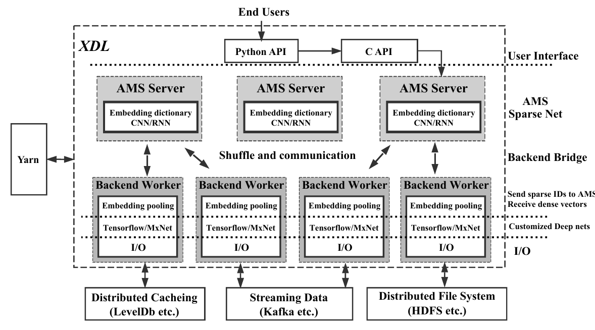
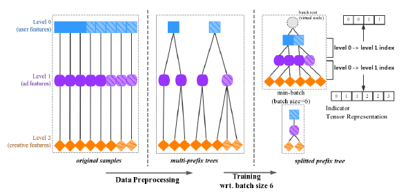
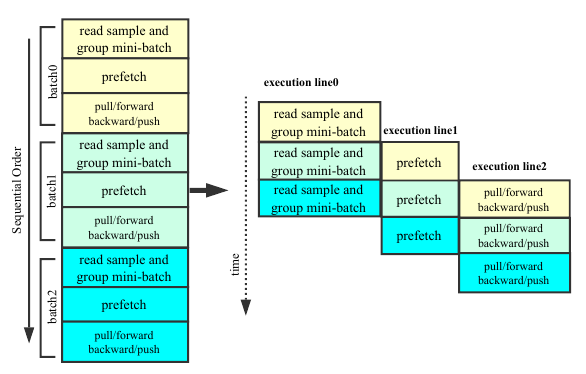
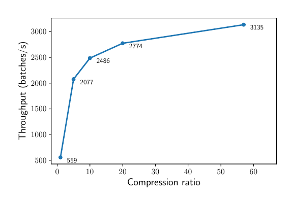
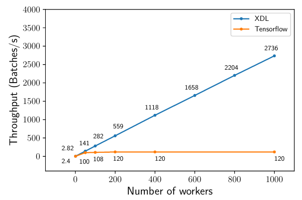

# XDL · 把同一批的重复特征读写合并起来

推荐模型通常同时有大嵌入表和小得多、但每批都要计算的稠密网络。用相同方式平铺两类参数，会遇到两种不同的瓶颈。嵌入表主要需要容量，单个小批只命中其中一些行。稠密参数体积小，工作者却频繁读取整组参数。XDL 把表征学习和稠密计算用桥接接口连起来，让服务器分别放置两类参数，再在工作者一侧处理重复键、流水线和后端计算。

## 一次点击怎样经过 AMS 和稠密后端

作者原图，Jiang 等，DLP-KDD 2019 图 2，PDF 第 4 页，按图框裁取。从下往上读是 HDFS、Kafka 等数据源，工作者读取样本并按特征键向 AMS 查询，当池化得到稠密输入后，TensorFlow 或 MXNet 后端计算分数与损失。反向通路把两类梯度推回 AMS，AMS 保存和更新稀疏及稠密参数。物理上，服务器和工作者可以同机，也可以分开。

以 §6.1 的 CTR 模型为例，物品键 $i$ 会读出一行 18 维向量。先按特征组做求和池化，得到 23 个向量，拼成 $23\times18=414$ 维输入，送入 $414\to200\to80\to1$ 的 DNN。点击是监督。工作者反传时，求和池化的每个输入收到同一个该组梯度。例如某一教学组只有 $i,j$，则 $z_g=E_i+E_j$，$\partial L/\partial E_i=\partial L/\partial E_j=\partial L/\partial z_g$。AMS 收到稀疏梯度后只写相应的行，也收集稠密梯度。论文的机制适用于多种后端，具体模型和梯度计算留在工作者端。

§3.3 用哈希映射存稀疏参数，把桶分散到服务端，工作者在查字典前合并请求。这里保留完整键，键 $i,j$ 同属某个分片时仍然有两行。若编码策略先把 $i,j$ 合并为同一模型键，两条梯度才会直接共享参数。[完整键与共享桶的区别](../../知识库/问题/稀疏ID哈希何时会共享参数.md) · [原文 §3.2–3.3](https://raw.githubusercontent.com/dlp-kdd/dlp-kdd2019/dbe75ef64ed2e44dc5198156af6aa286534ff19c/assets/pdf/a6-jiang.pdf#page=3)。

## 前缀树减少重复读取，每条曝光仍参与损失

若同一用户 $u$ 在小批里有两次广告曝光，原始行可能两次保存并传输同一份用户特征。XDL 在预处理时把特征按用户、广告、创意等层组织成前缀树。批组装达到上限时，拆分末棵树。相邻层的 indicator 张量让叶节点仍能找到共享的上层特征。两个不同广告曝光沿各自的叶节点读出特征和标签。若二者共同使用 $E_u$，计算图需把各条样本通过它的梯度累加回去。共享的是读取和中间表征，点击样本和其各自的监督都在。这个讲解便于区分三种单位：去重后的特征键、送入后端的样本、写回的参数行。

作者原图，Jiang 等，DLP-KDD 2019 图 4，PDF 第 6 页，按图框裁取。左侧是原始逐条样本，中间合并共同前缀，右边是凑够 6 条训练样本时切树并建立索引；颜色表示三个特征层。

## 流水线省等待，更新模式决定等待何时发生

作者原图，Jiang 等，DLP-KDD 2019 图 5，PDF 第 6 页，按图框裁取。图左按批串行，图右把读样本组批、预取、拉参和前后向分别放进三个执行流，用无锁队列衔接。使用 GPU 时，数据和上下文可异步拷贝至不同 CUDA 流。

论文还讨论提前计算下一批的 SparseNet 输出。若两个阶段分别需 4 ms 与 7 ms，串行每批 11 ms。理想流水填满后约每 7 ms 完成一批，单批前后依赖仍存在，初次填充和队列也有开销。如果上一批刚好也写物品 $i$，而下一批预取早于那次写入，它就可能用旧 $E_i$。原文强调相邻批共享的稀疏键较少时更适合这种预取。热键会使共享频率升高，吞吐提升需要和目标值一起测。

同步模式每轮等所有工作者的梯度并取平均，异步模式让工作者推送后独立推进，服务端无锁应用更新。稠密计算虽在工作者上，本论文中的稠密参数仍由 AMS 维护，实验所用是两类参数都无锁异步的设置。作者把稠密更新未全部写入类比为随机丢弃一部分梯度，此处是解释而非对偏差或收敛的证明。SSP 则明确规定读取需要见到哪个时钟以前的所有更新。流水先行会发生陈旧，单靠流水线结构无法推出 SSP 的窗口保证。[原文 §3.3、§4.2](https://raw.githubusercontent.com/dlp-kdd/dlp-kdd2019/dbe75ef64ed2e44dc5198156af6aa286534ff19c/assets/pdf/a6-jiang.pdf#page=5) · [SSP 的逐行时钟](../SRC-SSP/阅读笔记.md#缓存行存值也存达到的时钟)。

## 实验展示了什么类型的加速

作者原图，Jiang 等，DLP-KDD 2019 图 6，PDF 第 8 页，按图框裁取。在 200 工作者、80 AMS、CPU 模式、每批 5,000 条的实验中，重采样构造不同压缩比，低端及高端吞吐约为 559 和 3,135 批/秒。公开数据中的用户 ID 平均重复 57 次，重采样还改变了样本重复结构，不能将端点差值当成所有数据的固定倍率。

作者原图，Jiang 等，DLP-KDD 2019 图 8，PDF 第 8 页，按图框裁取。用公开淘宝样本、25 Gbps 以太网、80 AMS、批大小 5,000、压缩比 57，XDL 和原生 TensorFlow 均采用无锁异步。XDL 曲线在 200 与 1,000 工作者处标示约 559 与 2,736 批/秒。图 6 的高压缩点与图 8 的 200 工作者点，在文中所列几个规模条件接近时读数仍不同，原文未给足信息对齐两次运行，不将这两组数互作复现。图 7 改用样本/秒随批大小变化，不宜直接和批/秒读数相比。§6 的图主要测系统吞吐，未报告各设置在同一 AUC 或 LogLoss 下的收敛用时。原文还称异步几乎不损害模型效果，但图 6–8 本身没有提供验证这一判断所需的模型指标。[原文 §6、图 6–8](https://raw.githubusercontent.com/dlp-kdd/dlp-kdd2019/dbe75ef64ed2e44dc5198156af6aa286534ff19c/assets/pdf/a6-jiang.pdf#page=8)。

在线学习另有状态生命周期。新 ID 经过概率或计数布隆准入，长期未更新的 ID 可淘汰，持续训练后的变动可增量导出。这些机制控制内存和发布开销，也影响长尾键何时拥有独立向量。原文把工作者的样本读取位置一同写入 AMS，支持故障后恢复。恢复过程中是否完全无重读或漏读，仍取决于模型快照和输入偏移怎样对齐，正文没有给出端到端一致性协议。对照其他稀疏训练系统见[稀疏参数分布式训练怎样控制读写陈旧](../../知识库/问题/稀疏参数分布式训练怎样控制读写陈旧.md)。

## 原文与译本

采用 DLP-KDD 2019 主办方历史归档的九页 ACM 排版，核对实际文件名、会议与 19 位作者。录用页还列了一名作者，来源卡和译文按正式 PDF 的署名。正文 §6.2 指向 §4.3 说明异步更新，实际定义在 §3.3，译文标注了原印刷交叉引用。中文译本 13 页，已逐页核验。原文和中文 PDF 已通过私有附件的认证下载核验。见[访问说明](../../译文/PDF目录.md)。译本包含摘要、正文 §1–7、表 1–3、图 1–8 图注及脚注，图内文字和参考文献保留英文。Apache 2.0 适用于开源框架及其参考实现，论文按首页 ACM 权利声明处理。[出版条目](https://doi.org/10.1145/3326937.3341255) · [主办方录用页](https://github.com/dlp-kdd/dlp-kdd2019/blob/dbe75ef64ed2e44dc5198156af6aa286534ff19c/accept.md)。
