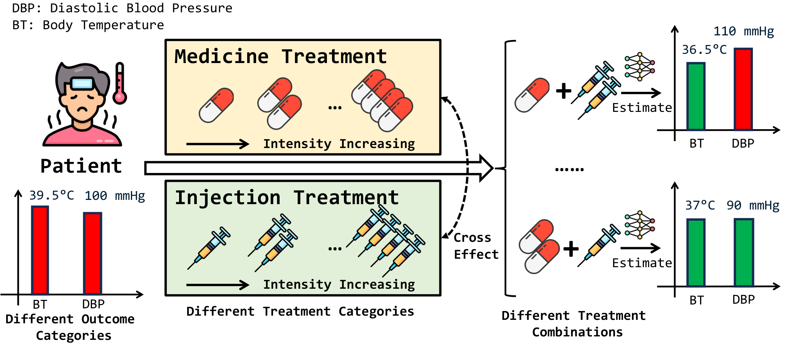
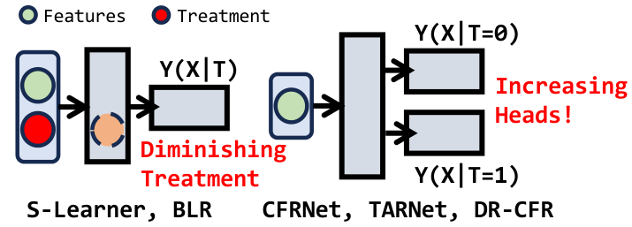
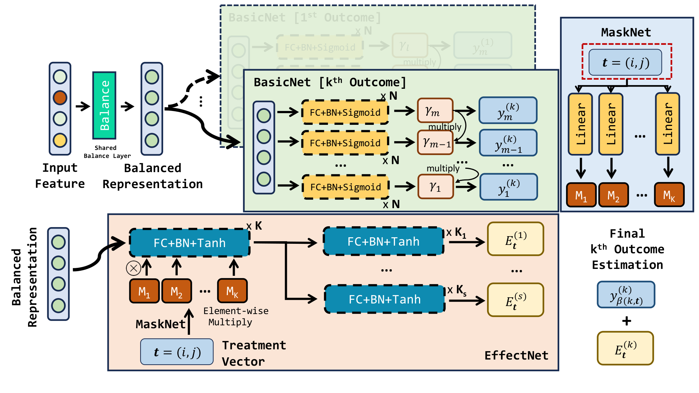

# XTNet 怎样为联合券档估计交叉效应

同一位乘客同时看到普通车折扣与高端车折扣时，两类订单会相互替代，也可能因为组合整体更有吸引力而共同增加。把两张券单独投放时的效果相加，容易错过这些交互。XTNet 用单类处理样本训练基本响应，再由联合券档生成一组参数遮罩，让共享网络针对本次组合输出交叉修正。采用 Ke、Yu、Zhang、Zhou、Shi、Men、Zhu 的 arXiv 2511.01641v1。 [采用版原文](https://arxiv.org/pdf/2511.01641v1)

## 为什么独立预测对联合折扣不够

图 1 来自 Ke 等的 v1 作者源码，原 PDF 第 1 页，完整转换为 PNG。图用口服药物与注射解释两类别、各有多种强度、结果同时包含体温与舒张压。营销里可对应普通车、高端车两类折扣，以及完单、GMV 或支出等不同结果。论文估计同一用户特征 $X=x$ 下两个完整动作向量的条件均值差。 [原文图 1、§3](https://arxiv.org/pdf/2511.01641v1#page=1)

设 $t=(t_s,t_p)$ 为普通车、高端车折扣档，$t=(0,0)$ 为无券。一个用户可以被给到 $(1,0)$、$(0,1)$ 或 $(1,1)$。其日志只记录事实组合。若估计同类用户在 $(1,0)$ 比无券多 2 个百分点完单、$(0,1)$ 多 1 个百分点，而实际 $(1,1)$ 只增加 2.4 个百分点，两单券效应相加会多报 0.6 个百分点。共同支持要检查完整的折扣对，两个坐标分别都出现过，仍可能没有 $(1,1)$ 的可比试验样本。 [原文 §3，式 (1)–(4)](https://arxiv.org/pdf/2511.01641v1#page=3)

图 2 来自 v1 作者源码，原 PDF 第 2 页。左图把处理和用户特征一起输入共享网络，右图为不同处理读出独立头。类别增加时，逐组合设头会随各类档数的乘积增长，稀疏组合的头也只能获得很少监督。统一输入模型理论上能表示交互，学习到何种关系取决于表示和训练数据。XTNet 的分支设计给基本效应和组合修正分别提供监督。 [原文图 2](https://arxiv.org/pdf/2511.01641v1#page=2)

## 两张券怎样改变同一个共享网络

图 3 来自 v1 作者源码，原 PDF 第 4 页。上方 BasicNet 用主处理提供基础值。蓝色 MaskNet 将折扣向量映射成参数遮罩。下方 EffectNet 用被遮罩的网络输出交叉修正，各类结果分别与基础值相加。 [原文图 3、§4](https://arxiv.org/pdf/2511.01641v1#page=4)

从上面的普通车和高端车券算例出发，若完单的主处理是普通车券，BasicNet 对普通车券给出水平值。例如无券预测 30%，仅普通车券预测 32%。算法 1 筛选单类处理样本来监督 BasicNet，主处理选择 $\beta$ 在正文按移除各分量后的平均结果差描述。论文没有充分说明对每个结果怎样取得该选择所需的反事实量，也未规定主处理改变时同分的处理方式。联合样本仍通过完整预测的事实损失更新组合修正。 [原文 §4.2 与算法 1](https://arxiv.org/pdf/2511.01641v1#page=4)

对普通车和高端车各给一档的 $(1,1)$，MaskNet 根据向量 $t$ 生成 EffectNet 各层的权重和偏置遮罩。对第 $l$ 层，$\widetilde W_l=M_l^W(t)\odot W_l$，$\widetilde b_l=M_l^b(t)\odot b_l$。若两个分量线性出现在不同层的遮罩中，多层组合可以产生跨分量的乘性依赖。遮罩是按参数的连续调制，正文没有要求它取 0 或 1。此时输出的交叉修正若为 0.4 个百分点，就得到联合完单率 32.4%。这相对主处理为正，但相对两种单券效应合计的 33% 为负。把整个 EffectNet 输出直接解释为经典交互项会混淆这两种基线。 [原文 §4.1–4.4、式 (5)–(20)](https://arxiv.org/pdf/2511.01641v1#page=4)

训练为同一个小批次做两次更新。先筛选单类处理并更新 BasicNet。再用完整批次的实际组合生成遮罩，计算组合结果，更新 EffectNet 与 MaskNet。后一项包括事实二元交叉熵和跨处理组的 Sinkhorn 表征距离。部署时对同一用户替换候选券组合，分别输出结果，比较所需对照。基础值加带符号修正后是否落在交叉熵需要的 $(0,1)$，采用版未给出完整实现约束。作者还提到基础头链式相乘可保持单调，完整预测的交叉项另需约束才能保留该性质。 [原文 §4.5–4.6、式 (21)–(24) 与算法 1](https://arxiv.org/pdf/2511.01641v1#page=5)

## 预算排序聚合了什么

若每次加一档的边际收益只按单一券种排序，容易忽略换一种组合消耗同样预算时的结果。MCMV-AUCC 先将组合按各离散档位之和 $q=\sum_j t^{(j)}$ 分组，再对同组动作的结果与成本取平均，用相邻强度组的 $\gamma(x,q)=[\overline Y(x,q)-\overline Y(x,q-1)]/[\overline C(x,q)-\overline C(x,q-1)]$ 描述边际回报。比如 $(2,0),(1,1),(0,2)$ 同属强度 2。若这些组合的成本或结果相差很大，强度平均不足以恢复组内最优优惠。原文的误差比较依赖成本与结果的单调性、边际收益递减和分组一致性。附录 A.2 的定量下界还附加交互规模、排序错误频率及处理空间密度等假设。 [原文 §5 及附录 A.2](https://arxiv.org/pdf/2511.01641v1#page=6)

在实际分配中，可把模型给出的完整折扣组合收益与成本交给候选策略，然后检验同预算下的总结果。TaQFormer 让各坐标查询共享的请求记忆，并以 OBS 预训练、RCT 门适配和一次并行读出共享动作。在 XTNet 中，折扣组合直接改变 EffectNet 的参数，并用单类样本训练主处理分支。MT-DML 用连续处理残差和用户敏感度学习局部线性响应。选择依赖于档位是否稳定离散、交互是否需要显式建模，以及训练数据有没有能辨识组合效应的覆盖。 [跨论文比较](../../知识库/问题/组合营销策略如何共享结构并估计因果增量.md)

## 论文的实验覆盖哪些场景

三组合成数据各有 64,000 训练、8,000 测试样本，以一半选择偏置样本和一半随机样本构造，交互复杂度不同。真实实验覆盖 546,262 位乘客，普通和高端出行各五档，合计 25 种折扣组合。真实数据报告排序误差 0.1100、MCMV-AUCC 1.1701，文中的 DR-CFR 分别为 0.1117、1.0885。DR-CFR 对照引用 Hassanpour 与 Greiner，附录 A.4 给出了多类改造。表 4 同时列出排序和预算指标，例如合成 2 加不平衡损失后排序误差由 0.2576 变为 0.2465，MCMV-AUCC 从 0.0692 变为 0.0529，体现了指标排序和预算回报的差异。 [原文 §6.1–6.4、表 1–4](https://arxiv.org/pdf/2511.01641v1#page=7)

线上在 32 个城市持续一周，表 5 报告相对于基线的 GMV +4.33% 与订单 +2.10%。它反映该次投放策略的整体结果。作者没有为每个券组合报告单独线上估计、置信区间及成本变化，策略对照数值无法直接用于其它预算和人群。 [原文 §6.5、表 5](https://arxiv.org/pdf/2511.01641v1#page=8)

## 原文与中文译本

- 核对作者预印本 12 页的摘要、正文、方法图与附录指标假设。原稿的会议信息和 DOI 含占位值，按 arXiv 版本引用。截至 2026-11-25，未运行作者模型。 [固定 PDF](https://arxiv.org/pdf/2511.01641v1) · [来源与哈希](来源.json)
- 中文译本保留作者署名、公式、表值、参考文献、附录与原图，翻译摘要、正文、图表说明、表头和算法描述。采用单栏重排。正式 PDF 位于 `.local/papers/SRC-XTNET/translation/XTNet_中文.pdf`，可编辑工程与实物附件在同一目录。 [私有备份下载说明](../../文档/工具/中文PDF发布.md)
