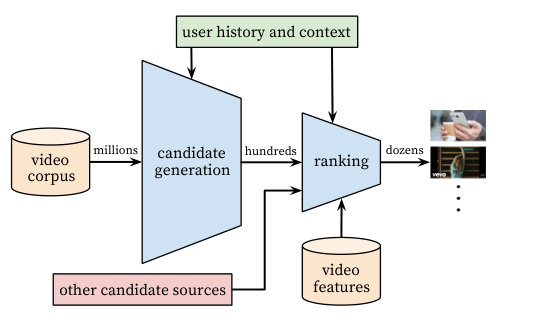
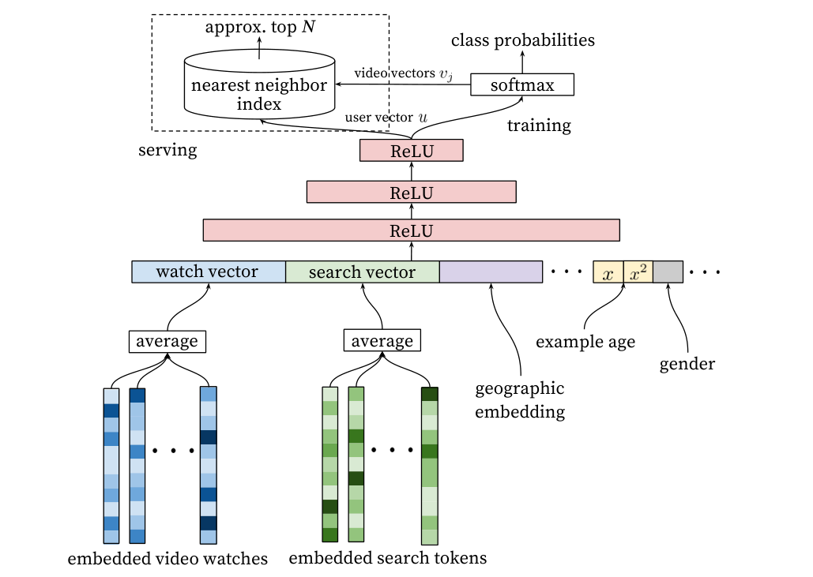
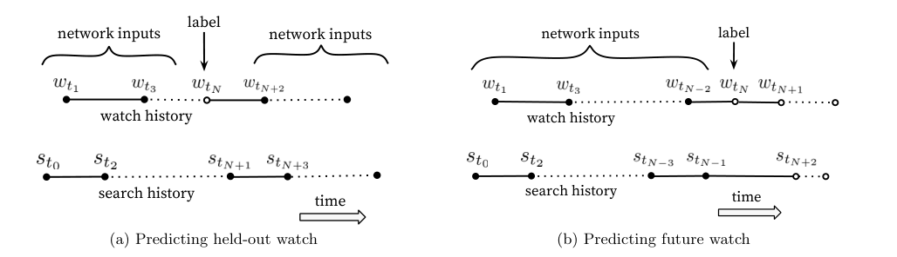
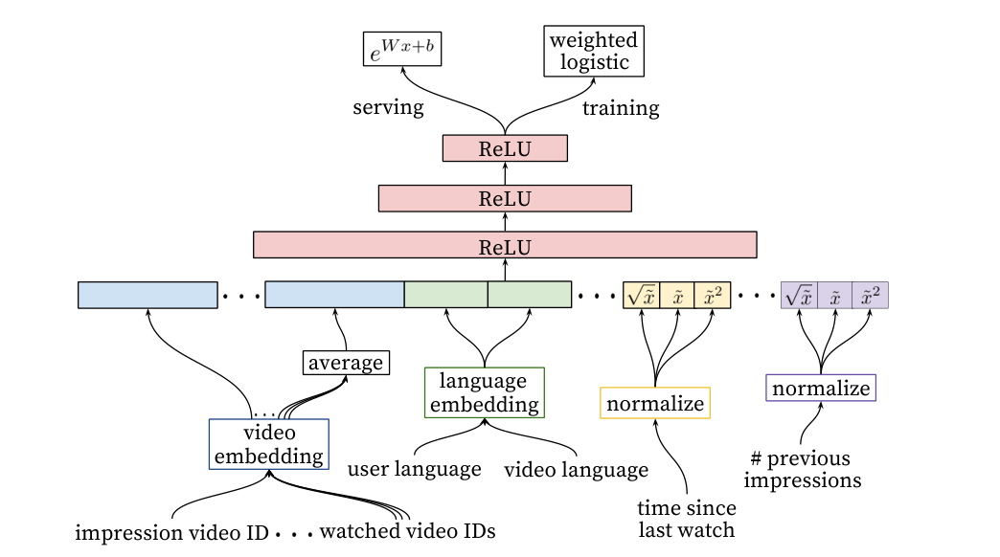

# YouTube DNN：用可检索的候选目标衔接观看时长排序

从百万视频到少量推荐，不能给每个物品都运行复杂排序网络。YouTube DNN把系统分成两步：先用用户向量与物品向量检索数百候选，再用更丰富的用户—物品特征预测排序价值。两阶段不仅计算不同，监督目标也不同：召回学下一观看类别，排序偏向期望观看时长。

本文固定Covington、Adams、Sargin的RecSys 2016《Deep Neural Networks for YouTube Recommendations》，191–198页，出版PDF8页。原件（本地）：`.local/papers/SRC-YOUTUBE-DNN/original/YouTubeDNN.RecSys2016.pdf`。

作者原图 2，RecSys 2016，固定 PDF 第 2 页。从左向右看视频库、几百个候选与最终列表。上下文同时影响两个阶段，排序还读候选特征与其他候选源。

## 多类预测把召回变成向量检索

候选网络把历史观看、搜索和上下文形成用户表示$u$，将下一观看视频$i$作为类别，模型写为

$$P(w_t=i\mid U,C)=\frac{\exp(v_i^Tu)}{\sum_{j\in V}\exp(v_j^Tu)}.$$

训练用采样类别及校正来避免百万级完整Softmax，通常每例数千负类；作者称比完整Softmax训练快两个数量级以上，不能当作系统服务提速。服务只需按内积取近邻，不必计算概率分母，物品向量可索引。§3.1分类公式、图2，PDF第2页（本地）：`.local/papers/SRC-YOUTUBE-DNN/original/YouTubeDNN.RecSys2016.pdf#page=2`。

观看和搜索嵌入先平均，连续特征及其变换再拼接进入ReLU网络。训练从序列中取一个观看作为标签，只用之前行为构造输入；跨来源观看使召回能吸收其他场景发现的信息，按用户等量采样抑制重度用户主导。它仍是在历史曝光与用户选择下学习观察分布，随机去掉部分上下文不能被解释为一般因果去偏。§3.2–3.3、图3，PDF第3–4页（本地）：`.local/papers/SRC-YOUTUBE-DNN/original/YouTubeDNN.RecSys2016.pdf#page=3`。

作者原图 3，同版 PDF 第 4 页。下方是观看、搜索和上下文的汇合，上方是同一个用户向量的两条路径。教学例取已看耳机、耳机套的历史，下一次看降噪耳机作为训练标签。若降噪耳机和球拍的内积分数分别为 1.4 和 0.5，两类教学词表下前者概率约为 0.711。真实训练分母覆盖更大的采样集合。线上请求只有前缀，直接搜索内积较高的物品。分母对同一请求的所有物品相同，因此分数顺序保持。

作者原图 5，同版 PDF 第 5 页。左图的随机留出可在标签右边看到后续观看，右图只有标签左边的历史。这决定训练时模型学到怎样的时间信息。

训练还增加example age，即$t_{max}-t_N$，表示**样本距训练窗口末端的年龄，不是视频年龄**。服务置零或略负，使模型倾向近期分布。它是在特征中处理时间偏移，不能保证不随用户偏好变化而失效。§3.3的Example Age小标题、图4，PDF第3页（本地）：`.local/papers/SRC-YOUTUBE-DNN/original/YouTubeDNN.RecSys2016.pdf#page=3`。

## 排序为何给正例按观看时间加权

点击概率可能偏好短视频或诱导点击。排序网络使用用户、物品和双方交互特征，目标更接近每次曝光期望观看时长。观看正例权重为观看时长$T_i$，未观看负例权重为1，训练加权二元交叉熵；服务使用输出odds。

作者原图 7，同版 PDF 第 6 页。输入侧新增候选、曝光和与候选的交互特征。顶部右分支接收是否观看和权重，左分支用指数把 logit 转为 odds。以教学例的两个候选各曝光 10 次计，若降噪耳机有 2 次观看、总时长 80 秒，球拍有 3 次观看、总时长 30 秒，odds 分别为 10 与 \(30/7\)。这个结果把观看总时长与未观看数联系起来，也解释了为何点击更多的球拍仍可能排在后面。

对一个条件固定、可自由拟合的分组，正例$k$、曝光$N$时，加权目标最优odds为

$$\frac{p}{1-p}=\frac{\sum_{i=1}^{k}T_i}{N-k}=\frac{E[T]}{1-P(\mathrm{watch})}\approx E[T].$$

其中$E[T]$以全曝光为分母，未观看时长视为0。只有观看概率较小时，分母近似1；它不是对任意点击率严格无偏的观看时间回归，也不是直接把每个样本的logit定义为时长。实际共享网络的有限容量与训练误差进一步限制上述最优值推导。§4.2，PDF第7页（本地）：`.local/papers/SRC-YOUTUBE-DNN/original/YouTubeDNN.RecSys2016.pdf#page=7`。

排序对同类特征共享嵌入，引入用户最近与视频、频道交互及候选来源等特征；特征工程和网络层数共同影响结果。表1按观看时长加权的用户内pairwise loss从线性41.6%降至最深配置34.6%，不等于CTR提升7个百分点。增加深度的收益递减，最深两组34.7%与34.6%，需结合复杂度判断。§4.1–4.3、表1、图5–7，PDF第5–7页（本地）：`.local/papers/SRC-YOUTUBE-DNN/original/YouTubeDNN.RecSys2016.pdf#page=7`。

## 表达与计算的分工不能跨协议排名

[MIND](../SRC-MIND/阅读笔记.md)在召回端输出多个兴趣向量，缓解单向量把不同兴趣平均掉；[DIN](../SRC-DIN/阅读笔记.md)让当前候选参与历史加权，更适合给已有候选打分；[IntTower](../SRC-INTTOWER/阅读笔记.md)试图保留预计算又增加交互。它们改变的是表示、候选参与位置和服务接口，不能据各自论文不同采样和数据的指标直接排名。问题比较见[两阶段训练目标](../../知识库/问题/两阶段推荐如何对齐候选与观看价值.md)。

作者报告深度候选网络相对此前系统的线上观看收益及特征增益，但本文部分0.2%、4.1%的原文说法未明确绝对百分点，译文保留原口径。文章未披露可完全复现的数据切分、随机化和置信区间；观看时长也不自动等于满意度或长期收益。论文提供了可复用接口设计，不能据此承诺迁移到另一业务的同幅收益。

实际阅读：全部8页摘要、正文§1–5、七图和表1，致谢与文献仅定位；未运行实现。交付中文正文Markdown（本地）：`.local/papers/SRC-YOUTUBE-DNN/translation/YouTubeDNN_中文翻译.md`及重排工程（本地）：`.local/papers/SRC-YOUTUBE-DNN/translation/reflow-sources/main.tex`，配图保留英文标签并关闭镜像读者高亮层，致谢与文献附英文原页。

2026-10-26补齐：按用户授权复用既有译文重新排版，交付中文PDF（本地）：`.local/papers/SRC-YOUTUBE-DNN/translation/YouTubeDNN_中文翻译.pdf`（12页）与可编辑工程（本地）：`.local/papers/SRC-YOUTUBE-DNN/translation/reflow-sources/main.tex`；最终各页已渲染目视，图表、公式及文献排版已核查。翻译范围沿用上述说明，原件、旧译文与诊断保留；本轮未运行模型实验。

2026-11-21 重读时补充实例与作者图。采用版原文及已有中文 PDF 已重新认证下载并核对页数、大小和完整 SHA-256。见 [PDF 备份说明](../../文档/工具/中文PDF发布.md)。
