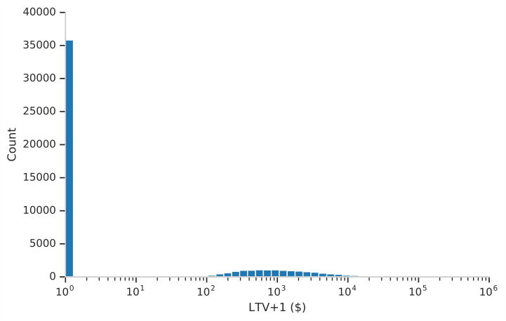
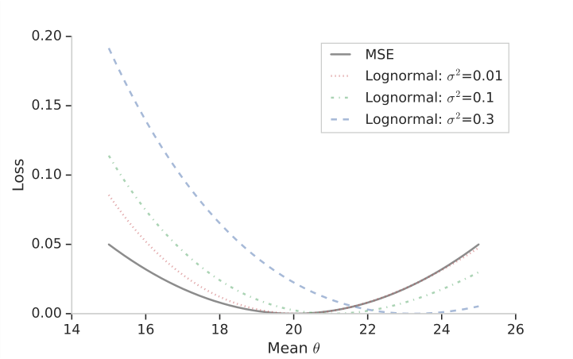
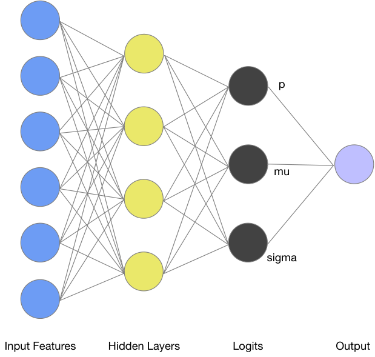
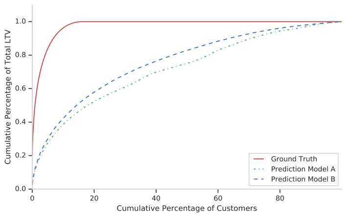
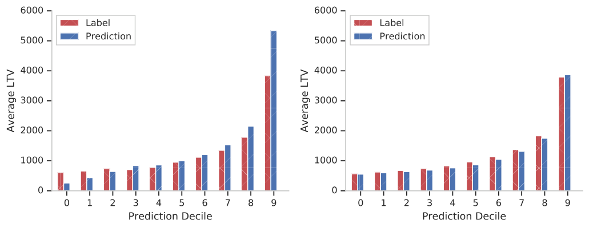
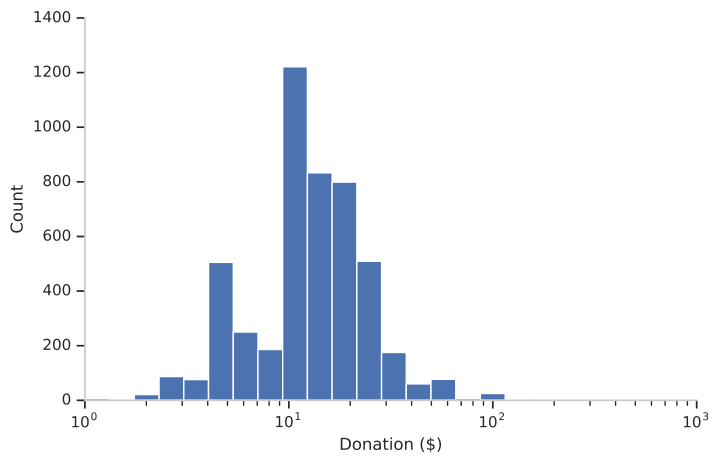
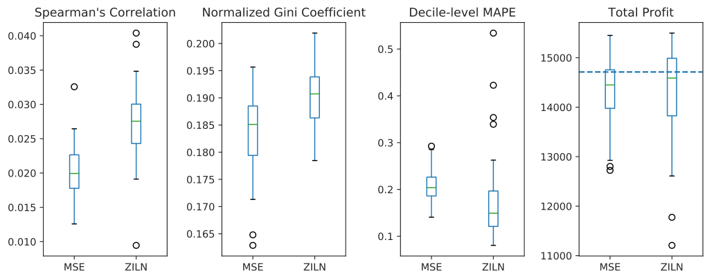

# ZILN：新客未来价值怎样同时容纳零值和长尾

客户第一次下单后，企业需要预测未来固定窗口的额外消费。Wang、Liu 和 Miao 用首购和注册特征预测窗口内有无复购，再估计复购者的金额分布，两项合在一个概率模型里。窗口末仍未购买的客户在标签里记为零。将窗口延长后，同一客户可能变为正值。 [arXiv v1 §1–3](https://arxiv.org/pdf/1912.07753v1#page=1)

## 先拆开零值和正值

直接用平方误差回归原金额时，预测的统计目标是条件均值。假设同组四人的后续金额是 0、0、20、380 元，常数预测的最优解是 100 元。这个单值不能区分复购机会和复购后的金额波动。若初始所有人都预测为 0，380 元样本的平方误差梯度绝对值是 20 元样本的 19 倍，小批量里有没有大额样本会明显改变更新。对 `log1p` 金额做回归可压缩差距，但把预测直接反变换通常得不到原金额均值。 [原文 §2–3、图 1–2](https://arxiv.org/pdf/1912.07753v1#page=3)

*图 1，固定版 PDF 第 4 页。Wang、Liu 和 Miao 的原图，按图区域裁取。横轴为对数尺度。*

*图 2，固定版 PDF 第 5 页，同一作者原图。画的是给定波动参数下的损失切片，不能据此认定真实尾部一定服从对数正态。*

## 一条样本怎样监督三个输出

首购商品、门店、金额和注册属性进入共享网络。头部输出复购概率 $p=\operatorname{sigmoid}(z_p)$、正金额对数的均值 $\mu=z_\mu$ 和标准差 $\sigma=\operatorname{softplus}(z_\sigma)$。给定输入 $x$，金额 $Y$ 有 $1-p$ 的质量在零点。有复购时，$\log Y$ 服从参数为 $\mu$、$\sigma^2$ 的正态分布。 [原文 §3，式 (1)–(4)](https://arxiv.org/pdf/1912.07753v1#page=4)

*图 3，固定版 PDF 第 6 页，作者原图，按图区域裁取。图中 Output 是组合读出，三个参数各有对应的激活。*

令 $b=\mathbf{1}\{Y>0\}$，逐样本负对数似然为

$$
\ell(y)=\begin{cases}
-\log(1-p), & y=0,\\
-\log p+\log(y\sigma\sqrt{2\pi})+\dfrac{(\log y-\mu)^2}{2\sigma^2},&y>0.
\end{cases}
$$

零值样本只更新二分类路径，正值还更新金额头。对概率头的 logit，梯度为 $p-b$。对正值样本的 $\mu$，梯度为 $(\mu-\log y)/\sigma^2$。两种任务都会经各自路径更新共享层。若某个客户预测 $p=0.3$、$\mu=\log 50$、$\sigma=0.8$，事实金额为 0 时只付出 $-\log 0.7$ 的损失。事实金额为 100 时，除了 $-\log 0.3$，金额头还用 $\log 100-\log 50$ 学习正值参数。实现上应先筛正标签再取对数，避免对零值求对数后用零掩码相乘。 [原文 §3，式 (3)–(4)](https://arxiv.org/pdf/1912.07753v1#page=5)

## 从复购概率和金额分布读出期望

上述客户的正值条件中位数是 50 元，正值条件均值为 $50e^{0.32}\approx68.86$ 元。全体条件均值还要乘复购概率，得到 $0.3\times68.86\approx20.66$ 元。因为预测分布有 70% 的质量在零点，这位客户的无条件中位数为零。任一分位水平 $q>1-p$，先映射为复购条件下的 $(q-1+p)/p$ 分位，再从对数正态分布读出金额。模型要给组合预算提供可加总的金额时，应使用原尺度均值。尾部参数偏差会通过指数放大，须按人群和窗口检查金额校准。 [原文式 (2)、附录 A](https://arxiv.org/pdf/1912.07753v1#page=16) · [LTV 的金额口径与补贴增量](../../知识库/问题/新客价值怎样预测零值和长尾金额.md)

## 排得准和金额算得准要分别测

按预测金额降序排列客户，纵轴累计的仍是真实收入份额。作者用该曲线相对于随机排序的有符号面积，除以真值排序的面积，得到归一化 Gini。正比例放大所有预测不会改变曲线，但十分位平均预测会偏高。十分位图按预测切组，逐组对比预测与真实均值。原文式 (5) 将十组绝对相对误差写成求和，虽然正文称为均值。跨项目比较必须先对齐是否除以十、真实均值为零时如何处理，以及正负方向和排序并列规则。 [原文 §4，图 4–5、式 (5)](https://arxiv.org/pdf/1912.07753v1#page=7)

*图 4，固定版 PDF 第 7 页，作者原图。图例中 B 是上方蓝色虚线，A 是下方绿色点线，原文图注却称 A 更好。读图应按累计真实收入曲线及图例判断。*

*图 5，固定版 PDF 第 8 页，作者原图。*

Kaggle 实验按公司对 2012 年首购数据做 80%/20% 客户随机切分，目标是随后的 12 个月金额。公司 10000 的归一化 Gini，首购金额基线为 0.813，DNN-MSE 为 0.750，DNN-ZILN 为 0.866。复购分类的 AUC-PR 与独立 BCE 接近，金额排序与复购分类可有不同改善。KDD Cup 1998 的目标是一次邮寄后的捐款金额，约 95% 标签为零。固定四层 DNN 重复训练 50 次，两损失的平均归一化 Gini 分别为 0.190（ZILN）和 0.184（MSE）。最佳一次 ZILN 的金额阈值回放利润是 15,498.24 美元，该数字对应 50 次中最高一次。 [原文 §5，表 2、4、图 6–7](https://arxiv.org/pdf/1912.07753v1#page=10)

*图 6，固定版 PDF 第 12 页，作者原图。分布取响应人群的正值。*

*图 7，固定版 PDF 第 12 页，作者原图。利润箱线图展示重复训练波动。*

按历史策略预测的 LTV 能为分层和收入预估提供输入。判断发券是否值得，要估计同窗发券与不发券的期望净收益之差，额外核对券成本、历史指派机制和实验支持。 [补贴效果的排序、幅度和策略价值](../../知识库/问题/怎样验证补贴增量的排序幅度和策略价值.md)

[固定原文与附录](https://arxiv.org/pdf/1912.07753v1) · [Google Research 题录](https://research.google/pubs/a-deep-probabilistic-model-for-customer-lifetime-value-prediction/) · [PDF 访问流程](../../文档/工具/中文PDF发布.md)。已读正文与附录 A 中的均值估计论证，中文译本覆盖摘要、正文 §1–6、正文图表说明和致谢。参考文献、附录与作者图内标注保留原文。
