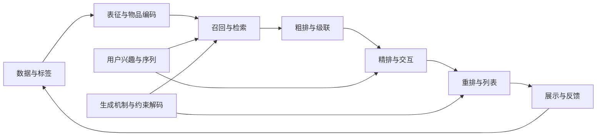

# 推荐系统：模块、问题与学习路线

推荐系统在用户状态、可用物品和业务约束下，决定此刻展示什么、以什么顺序展示，并从后续反馈学习。传统打分、向量检索、语义 ID 生成和列表生成，都可以放在这组共同问题下理解。

本知识库采用统一主干：**模块 → 问题 → 解法 → 论文**。模块按职责与接口组织，生成式推荐另有 [跨模块导读](生成式推荐专题.md)。这种结构既能比较同一问题的新旧解法，也容纳统一召排等对多个环节的联合改造。

搜索方向另从[查询、供给与相关性总图](搜索系统总图.md)进入：新增查询理解、改写规划、联想补全、相关性判断四类职责，召排、训练、解码、服务与评估沿用此处主干。该入口目前依据9篇摘要建立，尚未全文精读。

## 从决策链路看模块

这是一种常见的学习视图，不要求每个系统都具备独立粗排阶段。多任务、多场景、训练、评估、服务与探索横跨链路；联合模型也可能同时承担多个阶段。

| 模块                                 | 先理解的核心问题           | 与生成式路线的连接          |
| ---------------------------------- | ------------------ | ------------------ |
| [数据、样本与标签](../模块/数据、样本与标签.md)      | 观察到了谁、哪个事件、什么时间窗口？ | 历史序列与目标构造仍有曝光和时间边界 |
| [表征与物品编码](../模块/表征与物品编码.md)        | 怎样表达关系并唯一指向物品？     | 语义 ID、码本、内容与协同行为对齐 |
| [召回与检索](../模块/召回与检索.md)            | 怎样从大物品库找出候选？       | 生成检索与向量/混合检索       |
| [粗排与级联](../模块/粗排与级联衔接.md)          | 怎样分配计算并保留后续好候选？    | 统一召排如何改变阶段和预算      |
| [精排、交互与校准](../模块/精排、交互与概率校准.md)    | 怎样估计候选效用与概率？       | 大模型表征、候选打分及统一决策    |
| [用户兴趣与序列](../模块/用户兴趣与序列建模.md)      | 历史怎样转成当前用户状态？      | 大规模序列转导与条件生成       |
| [多任务与多目标](../模块/多任务学习与多目标决策.md)    | 多种标签如何共享，决策如何权衡？   | 多行为目标与偏好对齐         |
| [多场景、迁移与冷启动](../模块/多场景、迁移与冷启动.md)  | 哪些规律共享，哪些条件要保留？    | 预训练、内容迁移与协同对齐      |
| [重排、列表与约束](../模块/重排、列表与约束.md)      | 整张列表怎样优化？          | 列表生成、候选排列与约束       |
| [训练与偏好对齐](../模块/训练目标与偏好对齐.md)      | 用什么监督学到什么偏好？       | 序列似然、偏好优化与奖励       |
| [生成与约束解码](../模块/生成机制与约束解码.md)      | 如何生成有效且可执行的输出？     | 自回归、扩散、合法映射和搜索     |
| [评估、偏差与因果收益](../模块/评估、偏差与因果收益.md)  | 提升属于哪个任务、协议和收益？    | 有效输出率、解码成本和公平基准    |
| [在线服务与计算效率](../模块/在线服务、更新与计算效率.md) | 如何在预算内训练、更新并服务？    | 多步生成、缓存、算子与推测解码    |
| [探索与长期收益](../模块/探索、长期收益与策略学习.md)   | 推荐如何改变未来数据和用户状态？   | 生成策略与长期目标的评价边界     |

## 为什么统一组织

[Fun-rec](../../来源/SRC-FUNREC/阅读笔记.md)同时包含级联阶段、序列/多目标能力和生成式路线；[工业论文清单](../../来源/SRC-INDUSTRIAL-REC/阅读笔记.md)单列粗排、校准、延迟反馈与列表优化；[生成式清单](../../来源/SRC-GENREC-LIST/阅读笔记.md)同时涉及表示、架构、目标、解码和扩散。这些分类彼此交叉，适合在同一问题下比较。[Recommenders](../../来源/SRC-RECOMMENDERS/阅读笔记.md)中也已有 VAE 等生成模型，说明“传统/生成式”不是严格互斥的技术集合。

统一组织不意味着生成式只是替换一个小模块：它也可能联动物品编码、训练目标、搜索和链路分工。反过来，仅用 LLM 提取内容向量，也不等于端到端生成推荐。

## 先学什么

逐模块的经典起点和第一轮论文顺序见 [经典阅读路线](../阅读/经典论文路线.md)。经典基础、代表工作与较新路线分别标记；ESMM 已完成 [精读](../../来源/SRC-ESMM/阅读笔记.md) 和 [问题归纳](../问题/点击后转化率估计.md)，其余线索继续逐篇翻译与精读。

- **建立整体直觉**：数据与标签 → 表征 → 召回 → 精排 → 重排 → 评估。先能说明输入输出，再进入具体网络结构。
- **研究兴趣建模**：用户序列 → 多兴趣召回/候选条件精排 → 长历史效率 → 训练协议对齐。
- **研究生成式路线**：表征与 Tokenization → 生成检索 → 训练与对齐 → 约束解码 → 服务和评估；用专题页串联。
- **研究营销补贴或长期决策**：评估中的相关性/因果收益 → 多目标决策 → 探索与长期收益；专门的 uplift、预算分配文献后续定向补齐。

2026-10-25 的首轮框架依据九份固定版本 GitHub 资料的指定 README 范围建立，详见 [资源导读](学习资源导读.md)。模块中的机制解释是学习用的问题分解，论文线索与实际阅读入口统一见 [候选阅读表](../阅读/候选论文.md)；未读线索不构成方法优劣证据。ESMM 的已读结论进入具体问题页，其余逐篇学习后继续复用这些模块入口。
