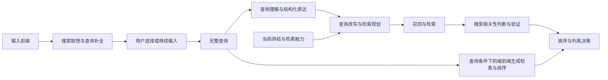

# 搜索系统：查询、供给与相关性的问题地图

搜索多了一份用户主动表达的需求。系统既要从不完整的前缀帮助用户形成查询，也要把完整查询变成可执行的检索条件，判断真实供给能否满足它，再决定展示哪些结果。用户历史可以补充歧义，但不能未经判断就替换当前查询的显式要求。后一条是这里提出的分析原则，尚不是这9篇共同验证的结论。

现有[推荐系统主干](推荐系统总图.md)已经覆盖候选发现、兴趣建模、召排级联、训练、解码和评估。缺口在于：它没有独立描述“查询是什么意思”“怎样改写和执行”“前缀该补成什么”“结果是否满足查询”。这四种输出不同，不能都并入召回：理解输出意图或结构字段；改写与规划输出检索请求；联想输出给用户选择的查询；相关性判断输出查询—结果的关系或验证决定。

这九篇搜索论文均已对照固定版本全文。下图按查询在系统中的用途划分模块，同一篇论文可能同时涉及两个环节。读到具体方法时，可从[九篇论文与原文入口](#九篇搜索论文与原文入口)查阅各篇精读、适用条件和仍缺的证据。

## 查询进入系统后的几种职责

这是按接口组织的学习图，不是9篇共同采用的架构。LEAPS横跨扩展与验证；OneSearch探索直接生成商品；联想输出还需要用户确认，不能把联想点击和商品点击当作同一事件。各条链路保留哪些过滤、回退与验证步骤，见下表的模块比较。

## 现有框架缺了什么

| 搜索模块 | 推荐中相近的内容 | 搜索中特有的问题 | 对照论文 |
|---|---|---|---|
| [查询理解与结构化表达](../模块/查询理解与结构化表达.md) | P5统一任务接口、多任务共享 | 搜索意图怎样变为一致、可消费的结构？领域口语与业务定义怎样对齐？教师标注和代理评委如何验证？ | LinkedIn、QP-OneModel |
| [查询改写与检索规划](../模块/查询改写与检索规划.md) | 召回覆盖、混合检索、服务预算 | 如何消除长尾语义缺口而保留意图？复杂查询怎样扩展且保留约束？如何依据供给与检索快照规划？ | BEQUE、EASP、LEAPS |
| [搜索联想与查询补全](../模块/搜索联想与查询补全.md) | 兴趣序列、生成解码、列表优化 | 不完整前缀怎样形成建议查询？城市变化怎样影响有效建议？偏好训练怎样对齐在线解码和时延？ | OneSug、LocalSUG |
| [搜索相关性判断与验证](../模块/搜索相关性判断与验证.md) | CTR/CVR精排、候选条件兴趣 | 怎样判断商品满足查询而非只预测点击？如何处理推理幻觉、多源证据和在线判断成本？ | TaoSR1、LEAPS |

例如，同一句“附近适合带孩子的餐厅”，联想要决定向用户展示哪条补全，规划要构造可执行的检索请求，验证则要判断返回的每家餐厅是否满足约束。三处都使用查询文本，输出与验收单位各不相同。

## 共享模块还需要补的四个搜索问题

**端到端生成怎样同时满足查询相关性与用户偏好？** OneSearch 让开放查询文本与其 SID 共同进入编码器，解码生成闭词表商品的 RQ-OPQ 编码。关键词和相关性校正用来训练表征，排序教师还将离线相关性分加进预测行为分。合法码、商品与查询相符、用户偏好各需不同证据。论文离线下单目标 HR@350 提高，MRR 略低；线上订单正向结果来自带奖励模型重排的实验组。[OneSearch 精读](../../来源/SRC-ONESEARCH/阅读笔记.md) · [短码检索比较](../问题/用语义短码直接检索物品.md#当前查询和商品编码承担不同的约束)

**搜索监督究竟来自哪里，奖励优化了哪个事件？** BEQUE 用倒排试搜的相关比例、优质商品覆盖或场景外命中构造改写偏序，EASP 全文用原查询相关性门控的预测 CVR 对齐检索计划，OneSug全文以行为等级规则奖励构造偏好，LocalSUG 以训练束的目标命中、名次和格式等条件分配奖励，订单样本另加权。它们不能仅因都用了对齐就看成同一监督：人工相关性、改写后的检索结果、联想选择、商品交互和转化发生在不同节点。已有[训练与偏好对齐](../模块/训练目标与偏好对齐.md)与[数据和标签](../模块/数据、样本与标签.md)可复用，新增问题是如何连接这些节点、控制日志曝光和未来信息泄漏。OneSug 全文未充分披露奖励统计窗和订单成熟期，详见[偏好比较](../问题/生成式推荐怎样从似然训练走向偏好对齐.md)。

**查询理解正确、搜得到、搜得准和业务收益怎样分别验证？** 结构生成需要看字段与组合的一致性；改写需要看意图保真和查询条件下的有效覆盖；联想需要看前缀与城市条件下的可用性；相关性判断需要看人工标注和不同难度的错误。再接线上点击、转化、留存与成本。这里列出的是后续比较维度，不是各论文均已报告的指标。已有[评估模块](../模块/评估、偏差与因果收益.md)保留离线/因果边界，还需按长尾、复杂约束、城市与供给状态分层，各论文采用的请求分布、候选集和指标口径也要分别核对。

**变化的供给怎样在延迟预算内进入决策？** [EASP](../../来源/SRC-EASP/阅读笔记.md) 在复杂路径取轻量检索快照，快路径直接进入搜索；[LocalSUG](../../来源/SRC-LOCALSUG/阅读笔记.md)每日更新城市共现参考，推理时用 QA-BS 和词表裁剪加速；LEAPS 通过插件接既有后端，分别披露扩展及逐商品验证的长度和服务配置。已有[在线服务](../模块/在线服务、更新与计算效率.md)可承接缓存、更新和推理成本，新增问题是快照时效、库存/门店变化、路由漏检与总链路预算。方案能否达到目标延迟，要读正文的请求分布、硬件、并发和回退配置，不能由“轻量”“低延迟”措辞推定。

## 九篇搜索论文与原文入口

| 论文与固定版本 | 已读范围内的技术方向 | 仍待核实的内容 |
|---|---|---|
| [OneSearch · 2509.03236v5](../../来源/SRC-ONESEARCH/阅读笔记.md) | RQ-OPQ、行为 SID 与 Q-Former、教师排序和真实行为反馈；输出商品码 | 奖励差边界、非法码及冲突回退、成本协议 |
| [BEQUE · 2311.03758v3](../../来源/SRC-BEQUE/阅读笔记.md) | 多指令 SFT、倒排试搜反馈、PRO 偏序对齐；线上读离线改写映射 | 离线生成的历史标题可见性、改写表刷新及增量指标汇总协议 |
| [TaoSR1 · 2508.12365v4](../../来源/SRC-TAOSR1/阅读笔记.md) | 规则 RAG 合成 CoT、离线偏好采样、动态难度 GRPO；首位四类概率分档 | 难度阈值写法、解释忠实性、业务 A/B 显著性和时延分解 |
| [OneSug · 2506.06913v1](https://arxiv.org/abs/2506.06913v1)，[全文精读](../../来源/SRC-ONESUG/阅读笔记.md) | BGE与共现查询增强前缀，RQ-VAE检索参考，BART/Qwen输出查询文本；行为等级成对/列表偏好加SFT，见[问题比较](../问题/短前缀怎样生成相关且有排序能力的查询建议.md) | 间隔损失印式与文字目标、奖励差稳定、统计可见时间及完整A/B协议；AAAI 2026 已核实，采用 arXiv v1 |
| [LocalSUG · 2603.04946v3](../../来源/SRC-LOCALSUG/阅读笔记.md) | 城市偏好共现候选动态注入prompt；beam驱动GRPO；质量感知beam加速与词表裁剪 | 与OneSug的直接技术继承关系；城市知识更新协议和无结果率统计口径 |
| [EASP · 2603.15262v2](../../来源/SRC-EASP/阅读笔记.md) | Probe-then-Plan；检索快照诊断；教师合成执行验证示范，SFT 与相关性门控预测转化 GRPO；复杂度路由 | 探针覆盖、快照时效、验证准则、计划格式及分位数协议 |
| [LinkedIn 结构化理解 · 2605.27441v2](../../来源/SRC-LINKEDIN-SQU/阅读笔记.md) | 统一结构化路由、标签、改写、分面和信任；离线教师与评委；职位实验与人员搜索复用 | 评委一致性样本分布、执行失败细分和跨域人评 |
| [QP-OneModel · 2602.09901v1](../../来源/SRC-QP-ONEMODEL/阅读笔记.md) | 依序生成实体、分词、权重、分类及意图；混合微调、近期人标与多奖励 GRPO | 意图描述奖励、缓存回退与少样本数据去重口径 |
| [LEAPS · 2601.05513v2](../../来源/SRC-LEAPS/阅读笔记.md) | 逆向增强、后验试搜 SFT、去重后的相关覆盖奖励；下游用原查询、OCR 与评论等筛选 | 证据冲突与弃权、候选预算分配、专家评估和全链路时延细节 |

这些论文描述了不同的改造位置。BEQUE偏向用系统反馈优化改写；EASP将供给与执行能力显式交给规划器；LEAPS把扩大候选和验证收敛分在前后两端。三者可围绕“改写能否执行并满足意图”比较，但当前还没有同任务、同预算、同数据的证据。[OneSug已读问题](../问题/短前缀怎样生成相关且有排序能力的查询建议.md)与LocalSUG共有前缀到查询接口，城市适配由后者的城市共现缓存承担；“特化版”只能作为任务类比，不能当作已核实谱系。

## 版本与阅读边界

上述入口最初基于固定版本摘要；2026-10-30已补齐OneSug v1的11页全文精读、8页中文正文PDF及问题整合，EASP 已对照 v2 全文及 LaTeX，并已验收正文中文 PDF，BEQUE 已对照 v3 全文及作者 LaTeX，7 页中文 PDF 已逐页验收。LEAPS 已对照 v2 全文与 LaTeX，12 页中文 PDF 已逐页验收。TaoSR1 已对照固定 v4 并验收 8 页中文 PDF。LocalSUG 已对照固定 v3 全文并逐页验收 15 页中文 PDF。OneSearch 已核对固定 v5 全文并逐页验收 18 页中文 PDF。LinkedIn 结构化查询理解已核对固定 v2 全文并逐页验收 17 页中文 PDF。QP-OneModel 已核对固定 v1 全文并验收 12 页中文 PDF。元信息中的首发/修订日期分别为：OneSearch 2025-09-03 / 2025-10-22；BEQUE 2023-11-07 / 2024-03-04；TaoSR1 2025-08-17 / 2026-03-10；OneSug 2025-06-07 / 同日；LocalSUG 2026-03-05 / 2026-08-25；EASP 2026-03-16 / 2026-04-29；LinkedIn 2026-05-22 / 2026-06-07；QP-OneModel 2026-02-10 / 同日；LEAPS 2026-01-09 / 2026-05-12。它们是arXiv时间，不统一替换成会议年份。

正式题名分别为：OneSearch: A Preliminary Exploration of the Unified End-to-End Generative Framework for E-commerce Search；Large Language Model based Long-tail Query Rewriting in Taobao Search；TaoSR1: The Thinking Model for E-commerce Relevance Search；OneSug: The Unified End-to-End Generative Framework for E-commerce Query Suggestion；LocalSUG: City-Preference-Enhanced LLM for Query Suggestion in Local-Life Services；Probe-then-Plan: Environment-Aware Planning for Industrial E-commerce Search；A Unified Structured Query Understanding Framework for Industrial Semantic Search；QP-OneModel: A Unified Generative LLM for Multi-Task Query Understanding in Xiaohongshu Search；LEAPS: An LLM-Empowered Adaptive Plugin in Taobao AI Search。

2026-10-26 的摘要盘点确定了最初的四个模块。九篇论文的固定版本、精读与证据边界现列于上表。原始书目与其余七篇推荐论文见[用户补充的生成式搜推论文](../阅读/候选论文.md#用户补充的生成式搜推论文)。
