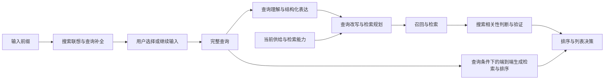

# 搜索系统：查询、供给与相关性的问题地图

搜索多了一份用户主动表达的需求。系统既要从不完整的前缀帮助用户形成查询，也要把完整查询变成可执行的检索条件，判断真实供给能否满足它，再决定展示哪些结果。用户历史可以补充歧义，但不能未经判断就替换当前查询的显式要求。后一条是这里提出的分析原则，尚不是这9篇共同验证的结论。

现有[推荐系统主干](推荐系统总图.md)已经覆盖候选发现、兴趣建模、召排级联、训练、解码和评估。缺口在于：它没有独立描述“查询是什么意思”“怎样改写和执行”“前缀该补成什么”“结果是否满足查询”。这四种输出不同，不能都并入召回：理解输出意图或结构字段；改写与规划输出检索请求；联想输出给用户选择的查询；相关性判断输出查询—结果的关系或验证决定。

本轮依据2026-10-26取得的9篇固定版本元信息与摘要建立学习框架。下面对论文的描述限定为作者摘要所述，模块边界与待研究问题是本库分析；未读正文、未翻译、未核验实现和实验协议，不据此登记已精读方案。正式题名和版本见文末，原用户清单仍可从[候选表](../阅读/候选论文.md#用户补充的生成式搜推论文)回查。

## 查询进入系统后的几种职责

这是按接口组织的学习图，不是9篇共同采用的架构。LEAPS横跨扩展与验证；OneSearch探索直接生成商品；联想输出还需要用户确认，不能把联想点击和商品点击当作同一事件。过滤、回退和验证是否仍存在，后续逐篇读实际链路。

## 现有框架缺了什么

| 新增模块 | 现有相近内容 | 仍未覆盖的对象与核心问题 | 摘要线索 |
|---|---|---|---|
| [查询理解与结构化表达](../模块/查询理解与结构化表达.md) | P5统一任务接口、多任务共享 | 搜索意图怎样变为一致、可消费的结构？领域口语与业务定义怎样对齐？教师标注和代理评委如何验证？ | LinkedIn、QP-OneModel |
| [查询改写与检索规划](../模块/查询改写与检索规划.md) | 召回覆盖、混合检索、服务预算 | 如何消除长尾语义缺口而保留意图？复杂查询怎样扩展且保留约束？如何依据供给与检索快照规划？ | BEQUE、EASP、LEAPS |
| [搜索联想与查询补全](../模块/搜索联想与查询补全.md) | 兴趣序列、生成解码、列表优化 | 不完整前缀怎样形成建议查询？城市变化怎样影响有效建议？偏好训练怎样对齐在线解码和时延？ | OneSug、LocalSUG |
| [搜索相关性判断与验证](../模块/搜索相关性判断与验证.md) | CTR/CVR精排、候选条件兴趣 | 怎样判断商品满足查询而非只预测点击？如何处理推理幻觉、多源证据和在线判断成本？ | TaoSR1、LEAPS |

每个新增模块先保留3个有内容的问题入口，共12个；具体解法、公式和证据在逐篇精读后进入正式问题页。此时不为每篇论文建立一个空的问题页。

## 共享模块还需要补的四个搜索问题

**端到端生成怎样同时满足查询相关性与用户偏好？** [OneSearch v5摘要](https://arxiv.org/abs/2509.03236v5)提出关键词增强的层次量化、多个视角的用户行为注入及偏好奖励系统。已有[语义码检索](../问题/用语义短码直接检索物品.md)讲物品表示与历史到物品生成，[级联模块](../模块/粗排与级联衔接.md)讲召排统一；尚缺当前查询、区分性商品属性和用户偏好之间的约束关系。后续要问：码的可映射性和商品满足查询分别由什么保证，奖励是否会牺牲相关性，过滤和回退还保留哪些阶段。继续复用表征、召回与级联模块，不另建“生成式召排”重复模块。

**搜索监督究竟来自哪里，奖励优化了哪个事件？** BEQUE摘要用离线系统给改写排序，EASP摘要用转化率对齐规划，OneSug摘要给行为赋权，LocalSUG摘要将相关性与业务奖励结合。它们不能仅因都用了对齐就看成同一监督：人工相关性、改写后的检索结果、联想选择、商品交互和转化发生在不同节点。已有[训练与偏好对齐](../模块/训练目标与偏好对齐.md)与[数据和标签](../模块/数据、样本与标签.md)可复用，新增问题是如何连接这些节点、控制日志曝光和未来信息泄漏；摘要不能给出完整归因窗口与采样协议。

**查询理解正确、搜得到、搜得准和业务收益怎样分别验证？** 结构生成需要看字段与组合的一致性；改写需要看意图保真和查询条件下的有效覆盖；联想需要看前缀与城市条件下的可用性；相关性判断需要看人工标注和不同难度的错误。再接线上点击、转化、留存与成本。这里列出的是后续比较维度，不是各论文均已报告的指标。已有[评估模块](../模块/评估、偏差与因果收益.md)保留离线/因果边界，还需按长尾、复杂约束、城市与供给状态分层，不能跨论文摘要数字排名。

**变化的供给怎样在延迟预算内进入决策？** EASP摘要给规划器检索快照并按复杂度选择启用；LocalSUG摘要将城市候选动态注入prompt而非写入参数，并使用解码加速；LEAPS摘要通过插件接既有后端。已有[在线服务](../模块/在线服务、更新与计算效率.md)可承接缓存、更新和推理成本，新增问题是快照时效、库存/门店变化、路由漏检与总链路预算。方案能否达到目标延迟，要读正文的请求分布、硬件、并发和回退配置，不能由“轻量”“低延迟”措辞推定。

## 9篇摘要分别带来了什么

| 论文与固定版本 | 摘要明确提出的方向 | 本轮不能从摘要确认的内容 |
|---|---|---|
| [OneSearch · 2509.03236v5](https://arxiv.org/abs/2509.03236v5) | KHQE保留层次语义和区分属性；多视角行为注入；PARS与奖励加权排序；生成式电商搜索 | 相关性如何约束合法物品生成、奖励具体形式、全链路成本协议 |
| [BEQUE · 2311.03758v3](https://arxiv.org/abs/2311.03758v3) | 多指令SFT、离线反馈、目标对齐；候选改写送入淘宝离线系统获得偏序，再作对比学习 | 在线缓存是否是主要服务形态、用户历史注入细节、偏序质量与偏差 |
| [TaoSR1 · 2508.12365v4](https://arxiv.org/abs/2508.12365v4) | 查询—商品相关性；CoT SFT、pass@N采样与DPO、难度动态采样与GRPO；推理后处理与概率分区支持上线 | “TaoSR系列”是否对应多篇论文、所谓自适应引导RL是否属于另一版本；业务规则和历史的具体使用 |
| [OneSug · 2506.06913v1](https://arxiv.org/abs/2506.06913v1) | prefix2query表征增强；编码器—解码器统一联想；按行为赋权的奖励排序 | 用户历史与商品语义的实际输入组织、候选与奖励构造、2026发表时间 |
| [LocalSUG · 2603.04946v3](https://arxiv.org/abs/2603.04946v3) | 城市偏好共现候选动态注入prompt；beam驱动GRPO；质量感知beam加速与词表裁剪 | 与OneSug的直接技术继承关系；城市知识更新协议和无结果率统计口径 |
| [EASP · 2603.15262v2](https://arxiv.org/abs/2603.15262v2) | Probe-then-Plan；检索快照诊断；教师合成可执行规划，SFT与转化率RL；复杂度路由 | 探针覆盖、快照时效、实际执行计划格式与总延迟分布 |
| [LinkedIn结构化理解 · 2605.27441v2](https://arxiv.org/abs/2605.27441v2) | 单SLM的Schema约束生成；Query Illuminator同时承担标注/蒸馏教师和代理评委；Job Search及People Search案例 | 用户清单列出的五项功能是否完整；结构定义、评委与人评一致性、跨域协议 |
| [QP-OneModel · 2602.09901v1](https://arxiv.org/abs/2602.09901v1) | SNS领域多任务序列生成；三阶段对齐到多奖励RL；意图描述增强下游改写和排序；涉及NER与词项权重 | 9类任务的准确清单、任务感知prompt格式、未见任务的划分与泄漏控制 |
| [LEAPS · 2601.05513v2](https://arxiv.org/abs/2601.05513v2) | 上游互补查询扩展与下游相关性验证；逆向增强、后验知识SFT、多样性RL；OCR/评论等证据与CoT | 各约束如何保真、验证与扩展的独立增量、多源证据冲突和成本 |

这些摘要描述了不同的改造位置。BEQUE偏向用系统反馈优化改写；EASP将供给与执行能力显式交给规划器；LEAPS把扩大候选和验证收敛分在前后两端。三者可围绕“改写能否执行并满足意图”比较，但当前还没有同任务、同预算、同数据的证据。OneSug与LocalSUG共有前缀到查询接口，城市适配是后者摘要强调的额外条件；“特化版”只能作为任务类比，不能当作已核实谱系。

## 版本与阅读边界

以上链接均指向本轮工具返回的固定版本摘要。元信息中的首发/修订日期分别为：OneSearch 2025-09-03 / 2025-10-22；BEQUE 2023-11-07 / 2024-03-04；TaoSR1 2025-08-17 / 2026-03-10；OneSug 2025-06-07 / 同日；LocalSUG 2026-03-05 / 2026-08-25；EASP 2026-03-16 / 2026-04-29；LinkedIn 2026-05-22 / 2026-06-07；QP-OneModel 2026-02-10 / 同日；LEAPS 2026-01-09 / 2026-05-12。它们是arXiv时间，不统一替换成会议年份。

正式题名分别为：OneSearch: A Preliminary Exploration of the Unified End-to-End Generative Framework for E-commerce Search；Large Language Model based Long-tail Query Rewriting in Taobao Search；TaoSR1: The Thinking Model for E-commerce Relevance Search；OneSug: The Unified End-to-End Generative Framework for E-commerce Query Suggestion；LocalSUG: City-Preference-Enhanced LLM for Query Suggestion in Local-Life Services；Probe-then-Plan: Environment-Aware Planning for Industrial E-commerce Search；A Unified Structured Query Understanding Framework for Industrial Semantic Search；QP-OneModel: A Unified Generative LLM for Multi-Task Query Understanding in Xiaohongshu Search；LEAPS: An LLM-Empowered Adaptive Plugin in Taobao AI Search。

原始工具响应与SHA256清单保存在本地忽略目录 `.local/research/搜索摘要盘点/20261026/`，是API解析的元信息与摘要，不能替代论文PDF原件。未逐项核实作者机构，未执行全文下载、源码翻译、实现阅读或模型实验。本轮的4个模块和问题分解是摘要驱动的组织入口；后续按候选编号逐篇走标准流程，再用原文证据补充或修订边界。本次范围只限用户选择的9篇，不代表搜索全领域综述。
