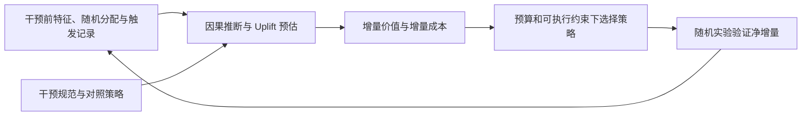

# 营销补贴：从因果增量到预算决策

营销补贴决定向谁、在何时、以什么规则给予激励，并判断新增价值是否值得支出。历史消费高或领券后转化高，并不等于这笔补贴产生了同样多的新增消费：一部分用户即使没有补贴也会购买。学习主线因此从干预和对照定义出发，先估计额外价值及成本，再研究预算内如何行动。

这是与[推荐](推荐系统总图.md)、[搜索](搜索系统总图.md)并列的业务学习方向，按具体职责复用知识模块。新增的主要模块为[因果推断与 Uplift 预估](../模块/因果推断与Uplift预估.md)，当前依据包括组合策略估计论文[POUL](../../来源/SRC-POUL/阅读笔记.md)与联合优惠券处理论文[TaQFormer](../../来源/SRC-TAQFORMER/阅读笔记.md)。预算优化与长期投放在下文明确为问题接口，尚无本方向的专门精读算法，不预建空模块。

## 让干预、效果与成本形成一条链路

这是一种决策问题分解，不代表POUL已经实现整条链路。尤其要保留“未触发”“未领取”和“实际核销”等不同事件：它们可能处于随机分配之后，直接按这些事件筛选用户会改变估计对象。规则定义应从[数据与标签](../模块/数据、样本与标签.md)回查。

| 学习环节 | 要回答的具体问题 | 现有入口与边界 |
|---|---|---|
| 干预与样本 | 对照是零补贴还是旧策略？随机的是用户、请求还是城市？实际触发是否改变样本？ | 数据、标签与[POUL的识别讨论](../../来源/SRC-POUL/阅读笔记.md#预估的是条件平均效应不是可观测的个人真值) |
| 条件效应预估 | 谁会因哪项干预多产生结果？组合策略如何共享信息？ | [因果/Uplift模块](../模块/因果推断与Uplift预估.md)、[组合策略问题](../问题/组合营销策略如何共享结构并估计因果增量.md) |
| 成本与预算 | 成本是面额、核销支出还是增量运营成本？如何在预算内选策略？ | 下节的目标接口；具体分配算法待有资料后比较 |
| 收益验证 | 排序、效应幅度与实际净收益是否一致？ | [评估模块](../模块/评估、偏差与因果收益.md)；AUUC改善不等于GMV或利润提升 |
| 长期与探索 | 多次投放是否改变后续反应，怎样获取新策略信息？ | [探索与长期收益](../模块/探索、长期收益与策略学习.md)；单期CATE不替代序贯策略价值 |

## 从增量预估走向预算决策

设 $t_0$ 为对照，$\tau_V(x;t,t_0)$ 为价值增量，$\tau_C(x;t,t_0)$ 为成本增量。一个帮助区分估计与决策的形式化接口是

$$
\max_{\pi}\ \mathbb E[\tau_V(X;\pi(X),t_0)]
\quad\text{s.t.}\quad
\mathbb E[\tau_C(X;\pi(X),t_0)]\le B.
$$

$\pi(X)$ 是为用户选择的策略，$B$ 在这里是相对对照的平均增量成本预算。这是问题分解用的数学定义，并非POUL提出或求解的优化算法。若业务给的是绝对支出预算，就需用策略下的总成本；若价值是GMV，还需按利润口径转换。券面额、核销支出和增量成本不能互换。

POUL分别报告GMV与Cost效应，提供了上游估计接口，但主表8项MAPE均未优于全部基线，说明只看排序就做金额决策仍有风险。价值、成本的尺度、误差与不确定性都应进入策略验证；在具体任务明确之前，不设固定ROI阈值或擅自选择业务指标。

## 从这篇论文继续学什么

先读[POUL精读](../../来源/SRC-POUL/阅读笔记.md)，理解两层随机概率、策略混合表示、残差化和证据限制；再读[TaQFormer精读](../../来源/SRC-TAQFORMER/阅读笔记.md)，理解坐标级处理查询、OBS--RCT适配和处理并行服务；沿[组合策略问题](../问题/组合营销策略如何共享结构并估计因果增量.md)比较类别ID、分别回归、组件共享与联合处理查询。

后续文献缺口包括二元CATE基础、多档/连续激励响应、成本约束分配、实验触发与干扰、长期投放。它们是阅读方向，不是已验证方法，也不自动授权训练或线上投放。当前只有本篇原文分析，没有本仓库模型复现或业务收益实验。
