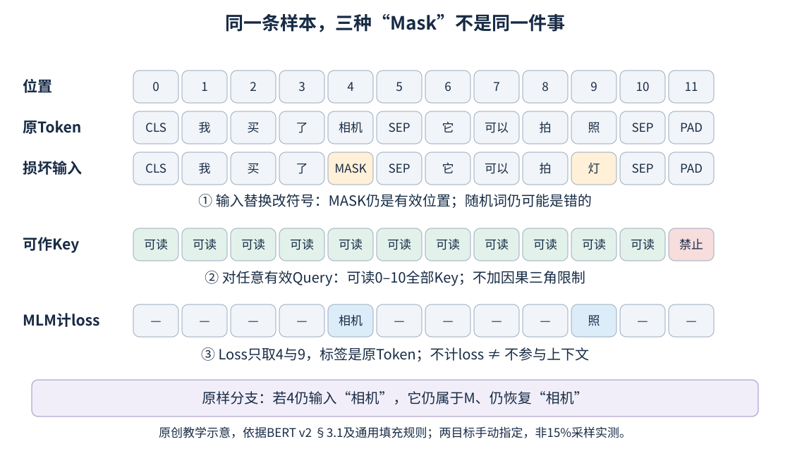

# Attention遮罩如何组合并处理填充位置

Attention Mask决定Query允许读取哪些Key；Loss Mask决定哪些目标位置参与监督。前者修改信息通路，后者修改训练目标，不能互相替代。因果mask也不规定计算器必须按Token写循环：已知输入时，可以把所有允许/禁止连接一次性放进矩阵。

## BERT恢复目标中的三种Mask

掩码语言建模里的“Mask”还可能指输入内容的损坏。要问清操作对象：换成MASK符号改变输入Token；Attention Mask改变Query能读取的Key；Loss Mask选择哪些目标计损失。三者不是先后替代的同一步。



从上到下读图：位置4被替为MASK、9被替为随机词，但二者仍是可读Key；PAD Key不可读；监督只取4和9的原Token。“不直接计loss”不等于不参与上下文或梯度。图与[BERT贯穿实例](../../来源/SRC-BERT/阅读笔记.md#从一条文本对构造输入和两种标签)引用同一实体，内容依据[BERT §3.1，固定v2第4页](https://arxiv.org/pdf/1810.04805v2#page=4)，其中padding部分是批处理解释，非作者实验。

若损坏输入为$\tilde x$、原文为$x$、选中集合为$M$，位置$i\in M$用同位置状态预测$x_i$，不做GPT式右移。BERT选中位置还含10%原样分支，所以“目标被选中”与“输入一定变成MASK”不等价；恢复标签仍在原位置。这些定义决定Loss Mask，不能从输入中是否出现MASK反推出完整监督集合。

下文再展开Attention可见性与填充的通用计算。

## 从布尔条件到Attention logits

以True表示允许，序列位置$i$、Key位置$j$的因果条件是$j\le i$，有效键条件是$token_j\ne PAD$。两者必须同时满足，故$allowed_{bij}=(j\le i)\land valid_{bj}$。如果某API用True表示禁止，则要先换语义，不能原封不动搬用逻辑与。

把允许转成0、禁止转成$-\infty$后，得到加性mask $M$，放在Softmax之前：

$$P_{bhij}=\operatorname{softmax}_{j}(S_{bhij}+M_{bij}),\quad S=QK^\top/\sqrt{d_k}.$$

加性因果mask与加性padding mask可以相加，布尔“允许条件”则用逻辑与；这是表示方式的对应。直接把分数乘0不会屏蔽，因为$\exp(0)=1$仍参与分母。[Transformer §3.2.3](https://arxiv.org/pdf/1706.03762v7#page=5)报告禁止logit置$-\infty$；布尔逻辑和广播是该公式的实现展开。

### 独立候选共用历史时怎样限制可见性

把两个候选 A、B 接在同一段历史后，普通三角因果遮罩会让位置在后的 B 读到 A。若要分别打分，候选各自只读历史和自身，历史也不能回看候选。HSTU 的 M-FALCON 清除三角遮罩中的候选间连边，同时调整相对位置与时间偏置，使合批计算与逐候选计算一致。[HSTU v3 §3.4](https://arxiv.org/pdf/2402.17152v3#page=6) · [图 11](https://arxiv.org/pdf/2402.17152v3#page=24)

这组可见性条件可以用布尔关系表达，实际如何屏蔽取决于注意力核。HSTU 对含相对偏置的 $QK^\top$ 分数逐元素施加 SiLU，再用所得权重聚合 $V$。合批复用的计算量见[目标感知排序](../问题/目标感知排序怎样复用历史计算.md)。[HSTU v3 §3.1 式 (2)](https://arxiv.org/pdf/2402.17152v3#page=4)

## make_std_mask的逐轴过程

固定Annotated Transformer中的实际代码是：

```python
# tgt: [B,T]，此处True表示可读；原教学实现的静态摘录
valid_keys = (tgt != pad).unsqueeze(-2)   # [B,1,T]
allowed = valid_keys & subsequent_mask(tgt.size(-1))  # [B,T,T]
```

`subsequent_mask(T)`返回$[1,T,T]$的布尔下三角，含对角线。逻辑与时，$[B,1,T]$沿Query轴广播，$[1,T,T]$沿batch轴广播，输出$[B,T,T]$；进入`MultiHeadedAttention.forward`后再`unsqueeze(1)`为$[B,1,T,T]$，供$[B,H,T,T]$分数的各头使用。不能把教学函数的返回值直接称为四维。

若实现从一开始使用四维mask，常见有效键形状是$[B,1,1,n_k]$，因果形状是$[1,1,n_q,n_k]$，合并后$[B,1,n_q,n_k]$再在head轴广播。交叉注意力的源Key padding同样只沿$n_k$屏蔽，通常不对源目标轴附加自回归三角。[固定教学代码Batch、subsequent_mask与MultiHeadedAttention](../../来源/SRC-ANNOTATED-TRANSFORMER/阅读笔记.md#遮罩与标签平滑要连着看)

例如右填充输入`[BOS,A,PAD,PAD]`的组合可见矩阵为

```text
              BOS A PAD PAD
Query BOS       1 0  0   0
Query A         1 1  0   0
Query PAD       1 1  0   0
Query PAD       1 1  0   0
```

这直接展示：PAD Key不会被读到，PAD Query仍能读取BOS和A。PAD Embedding为零也不保证Query输出为零，后续Attention、偏置、位置表示与残差都可能产生非零状态。

## PAD输出和PAD监督分别处理

若每层有效Token都禁止读取PAD Key、运算其他部分是逐位置的，且最终loss不使用PAD目标，那么PAD Query的非零输出可以留作不使用的结果。若后面做池化、辅助loss或其他跨位置聚合，就必须重新屏蔽这些位置，必要时安全置零；“所有PAD Query都必须清零”和“永远无需管PAD输出”都过强。

对于目标$y$，常用无平滑的Token交叉熵写成

$$L=-\frac1{N_{valid}}\sum_{b,t}\mathbf1[y_{bt}\ne PAD]\log p_{bt}(y_{bt}),\quad N_{valid}=\sum_{b,t}\mathbf1[y_{bt}\ne PAD].$$

有效输入mask与标签mask还可能错开：右移输入的最后一个有效位置有时对应PAD标签，所以mask输入Key不能自动解决标签问题。实现可用`ignore_index`或显式loss权重；若使用标签平滑，目标分布与归一化约定另核。全批没有有效标签时分母为0，也需单独处理。以上loss是解释监督的标准形式，原Transformer另采用$\epsilon_{ls}=0.1$标签平滑；教学实现的`Batch.ntokens`与`LabelSmoothing`提供静态对照。

## 一整行没有合法Key时为什么危险

一行全为$-\infty$时，形式上的$\sum_j\exp(-\infty)=0$，无法得到概率分布；稳定Softmax先减行最大值又遇到$-\infty-(-\infty)$，朴素实现会NaN。具体融合算子可以约定全遮罩行输出0，不能因此说所有Softmax都天然安全。

若**把整行替换为相同有限常数**$-C$，稳定Softmax得到均匀分布，而非全0。如果只是给所有原logit都加$-C$，精确算术下Softmax完全不变；有限精度下也可能因分数被舍入为相同值而变均匀。两种操作都没有表达“没有任何可读Key”。有效Query至少应有一个允许Key；无效Query可采用有明确全遮罩语义的实现，或在Softmax前构造安全替代行、计算后屏蔽输出，避免NaN进入反传。只在出现NaN后乘0并不能消除NaN。

## 左填充和右填充怎样选择

右填充把有效Token放在前部，便于训练时保持原位置与标签对齐；左填充让每条有效前缀的最后Token位于数组末列，便于某些批量生成实现统一读取末列logits。选择取决于数据构造、位置编号和读出逻辑，没有一个方向适用于所有模型与接口。

因果模型的右填充有效Query不会读取右侧PAD；即使如此，Loss仍要排除无效标签，句级Pooling仍要排除无效状态。左填充则可能让有效Query读取左侧PAD，通常要配Key padding mask，并使position IDs按训练约定对齐；最左PAD Query若无任何合法Key，还需处理全遮罩行。

若批量生成直接读`logits[:,-1]`，右填充短序列读到的是PAD Query的结果，不能称其为最后真实Token预测。可改用正确末有效索引，或选用支持左填充且正确处理位置与mask的实现。[末位置与Pooling](Token表示怎样汇聚成序列表示.md#右填充时怎样取末位置和做均值)给出索引公式。

GPT官方ROCStories脚本采用右填充，`M`只作Loss mask；它利用有效前缀在PAD之前的因果条件，不是已经实现了通用Key padding mask。[固定代码](../../来源/SRC-GPT1-CODE/阅读笔记.md#错位标签与损失平均)。

## 因果依赖为何不阻止训练并行

训练时，当前层全部位置的输入已经由上一层给定；$QK^\top$和$PV$的每一行都能从这些已知矩阵中直接计算。禁止未来连接等价于删去部分边，并没有把同层第$i$行的输出变成第$i+1$行的输入。层与层仍依次执行，序列位置可在层内并行。推理逐步生成则来自未来Token尚未知，具体见[右移监督与Teacher Forcing](Transformer训练与机器翻译.md#右移监督与teacher-forcing)。
