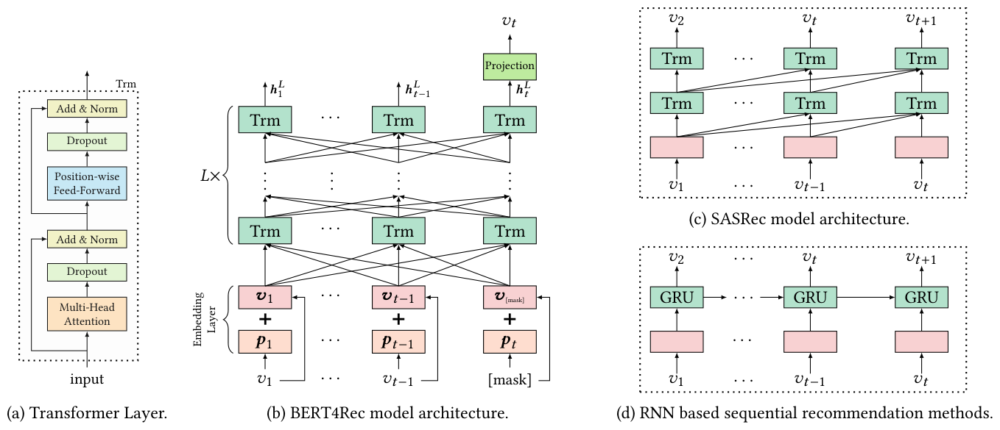
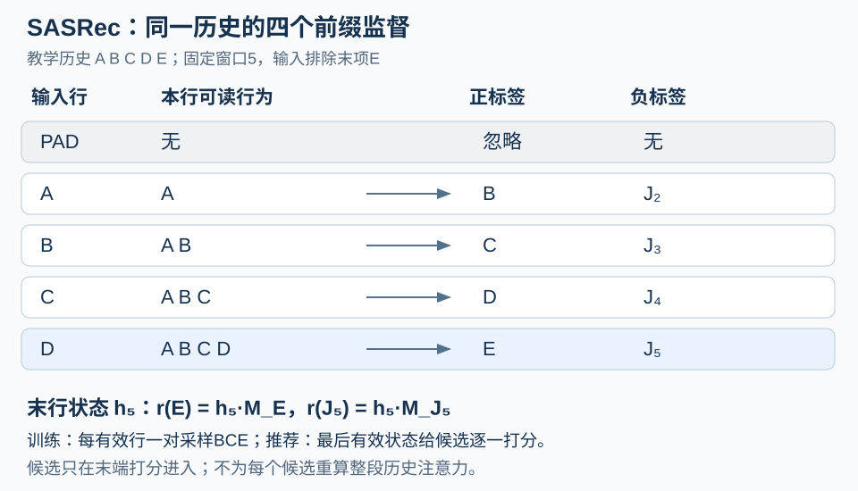
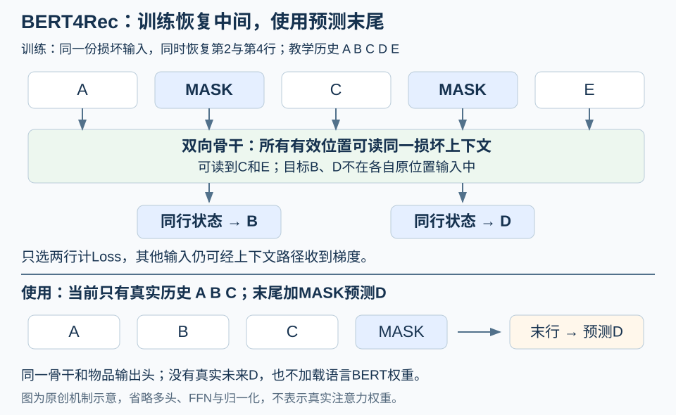

# 从历史顺序预测下一物品：因果预测与双向恢复

同一用户在不同时间可能处于不同任务。静态用户向量能概括长期偏好，却未必分清当前在找什么；只看最后一次行动又可能丢失较远上下文。下一物品推荐需要把截至当前的有序历史转成状态，并在预测时仅依据已发生历史作下一步决策。训练则可选择按前缀预测，或先在训练窗口中做被遮物品恢复，两者的条件不同。

[SASRec 精读](../../来源/SRC-SASREC/阅读笔记.md)给出一种方法：在固定最大窗口内，用因果自注意力自适应聚合历史。这里的“自适应”指权重随历史内容和位置变化，不代表模型跳过了其他历史位置的计算。

## 训练位置与可见前缀必须对齐

对 A、B、C、D，输入 A、B、C，目标 B、C、D。位置 B 的状态可见 A、B，用来预测 C，不能看见输入中的 C。只把目标错位而不遮住未来，会让训练任务泄漏答案。

SASRec 把输入截断为最近 $n$ 次，不足时左填充；第 $i$ 个位置表示为 $H_i=M_{s_i}+P_i$，其中 $M$ 为物品向量表、$P$ 为可学习位置表。自注意力投影 $Q=HW^Q,K=HW^K,V=HW^V$，聚合为：

$$
S=\operatorname{softmax}\left(\frac{QK^\top}{\sqrt d}+C\right)V,
\qquad C_{ij}=-\infty\ \text{当}\ j>i.
$$

$d$ 是向量维度，softmax 在每一 query 行上归一化；填充不能成为真实历史或监督。遮罩使全部训练位置可以并行计算，同时保持各自的历史边界。原文未在该式完整列出填充遮罩代码，不能从零填充直接推断所有实现细节。[§III-A–B、式 (1)–(3)，PDF 第 3 页](https://arxiv.org/pdf/1808.09781v1#page=3)。

每个位置再用 $\operatorname{ReLU}(S_iW_1+b_1)W_2+b_2$ 变换潜在维度。堆叠自注意力与前馈块，配合输入归一化、Dropout 和残差，得到状态 $h_t$。默认输入/输出共享物品表，分数为 $r_{i,t}=h_tM_i^\top$；非线性历史变换允许转移不对称。先形成历史状态、后对不同候选内积，不需要按候选重算整段注意力。[§III-C–D、式 (4)–(6)，PDF 第 3–4 页](https://arxiv.org/pdf/1808.09781v1#page=4)。

## 编码历史与选择训练目标是两个决定

本篇采用每个有效位置一个正例、每 epoch 一个随机负例的二元损失：

$$
\ell_{\mathrm{BCE}}=-\log\sigma(r_+)-\log\sigma(-r_-).
$$

这是按实际采样说明表达的形式。原文完整负例求和需要相应缩放才能与采样期望对应；[固定作者实现](../../来源/SRC-SASREC-CODE/阅读笔记.md#训练负例与损失归约)均匀抽样并拒绝整个用户训练集合，按batch有效目标数归约，未运行训练。它也不是全物品 softmax，不能直接解释为真实环境下校准的物品选择概率。[§III-E，PDF 第 4–5 页](https://arxiv.org/pdf/1808.09781v1#page=5)。

[BPR 相对偏好问题](隐式反馈的相对偏好学习.md)则以 $\ell_{\mathrm{BPR}}=-\log\sigma(r_+-r_-)$ 调整分差。两者可共用打分器，但目标不同；给正负分数同时加常数，BPR 数据项不变，二元损失会变。SASRec 是序列编码与训练方案，BPR 是可适配不同打分器的准则，不能将二者直接当作互斥架构。[BPR §4.1，PDF 第 4 页](https://arxiv.org/pdf/1205.2618v1#page=4)。

| 历史处理 | 依赖与取舍 | 当前证据 |
|---|---|---|
| 固定阶物品转移 | 预先规定看最近几次；简单，但范围需选择 | SASRec 本篇中的 FMC/FPMC 等对照，未独立精读其原论文 |
| RNN 隐状态 | 顺序更新历史状态；存在跨时间步串行依赖 | SASRec 本篇的 GRU4Rec 系列对照，未独立精读其原论文 |
| 因果自注意力 | 窗口内内容/位置决定权重，训练位置可并行；注意力含二次项 | SASRec 正文与消融 |

没有位置向量不等于没有一切顺序信息：因果前缀、最后 query、残差和多层聚合仍可能利用结构顺序。论文无 PE 的消融应读为去掉一个显式位置来源，不能直接称为完全无序模型。

## 把同一段历史放进两种训练任务

作者原图 1，Fei Sun 等，arXiv 1904.06690v2 第 3 页。先看右上的 SASRec 哪些历史箭头跨位置，再看中间 BERT4Rec 的末尾 [mask] 如何读整段已发生历史。中间图对应末位预测，下面的两处中间遮罩是训练算例。见 [BERT4Rec 精读](../../来源/SRC-BERT4REC/阅读笔记.md#双向编码改变历史内部的信息流)。

用同一条教学历史ABCDE作对照，ID只是行为标识。关键区别不在“读左边还是两边”这一句话，而在**每个输出状态被要求预测什么**：

| 环节 | SASRec前缀监督 | BERT4Rec窗口恢复 |
|---|---|---|
| 本次输入 | A、B、C、D | A、MASK、C、MASK、E |
| 取哪些状态 | A至D四行 | 第2、第4行 |
| 各行标签 | B、C、D、E | B、D，均恢复同位置原ID |
| 预测B的条件 | 仅A | 同一损坏序列中的可见A、C、E及MASK状态 |
| 训练输出 | 每行正例/随机负例的独立分数 | 每选中行全目录上的一个Softmax分布 |
| 本次Loss | 四个采样BCE项再按约定归约 | 两个目标的负对数概率平均 |

两列使用了不同训练输入，因为任务本身不同；不能据此将预测B时BERT4Rec已见C、E解释为在线请求偷看未来。恢复任务允许窗口右侧，实际下一项请求只提供发生过的历史。若在线历史为ABC，SASRec读取C行预测D；BERT4Rec输入ABC、MASK，读取新增MASK行预测D。[SASRec §III-A–E，第3–5页](https://arxiv.org/pdf/1808.09781v1#page=3)；[BERT4Rec §3.5–3.6，第4–5页](https://arxiv.org/pdf/1904.06690v2#page=5)。

沿上图A到D逐行读，每行都有自己的前缀条件与正负标签，不能把前向矩阵并行误解为共享完整未来；最后D行只在训练中用E作标签。

下图上半部两行输出同时基于同一损坏窗口，下半部换成当前只有ABC的请求；两个任务接口由“末项恢复”训练样本衔接。两图复用各论文图实体，省略内部算子；详细数值与梯度分别见[SASRec算例](../../来源/SRC-SASREC/阅读笔记.md#用同一位置算出正负分数损失和梯度)、[BERT4Rec算例](../../来源/SRC-BERT4REC/阅读笔记.md#一个损坏序列怎样产生两个不同的预测)。

输入与输出共享物品表时，还要问一次预测会更新哪些行。SASRec 每个有效位置抽一个负例，输出端直接更新正、负候选行；BERT4Rec 在被遮位置做全物品 Softmax，分母里的其他候选也参与该位置的输出梯度。两者的输入查表梯度都沿各自的历史计算路径累加。共享规定参数如何复用，损失和候选集决定一次监督涉及的行。[共享权重的梯度](../概念/词表嵌入与权重共享.md#查一行向量与给整个词表打分) · [SASRec 反传算例](../../来源/SRC-SASREC/阅读笔记.md#从打分到物品表和位置表的一次反传) · [BERT4Rec 的 MASK 损失](../../来源/SRC-BERT4REC/阅读笔记.md#只在mask计损失为什么上下文物品也会训练) 即使一个输入位置不直接计损失，它的状态仍可通过注意力影响被监督位置。

## 效果和效率都要附带候选与窗口

作者在 Beauty、Games、Steam、ML-1M 上逐用户留最后一次测试、倒数第二次验证；测试输入含验证行动。每用户只对真实物品和100个随机负物品排序，报告采样 Hit/NDCG@10。四数据 SASRec 的 NDCG 分别为 0.3219、0.5360、0.6306、0.5905，均为作者表 III 的结果，没有本仓库复现。不能将它们与全物品指标或 [BPR 原论文的 AUC 协议](../../来源/SRC-BPR/阅读笔记.md)直接排名。[§IV-A–E、表 II–III，PDF 第 6–7 页](https://arxiv.org/pdf/1808.09781v1#page=7)。

固定块数下，主要计算是 $O(n^2d+nd^2)$，而非对窗口长度线性。单 GTX-1080 Ti、ML-1M、截断200时，作者测得1.7秒/epoch，对照截断相同长度的 Caser 为19.1秒、GRU4Rec+为30.7秒；这是训练条件下的加速。历史编码后单候选内积为 $O(d)$，全物品扫描仍为 $O(|I|d)$，线上缓存、更新与 ANN 的效果未在本篇验证。[§III-F、IV-G，PDF 第 5、8–9 页](https://arxiv.org/pdf/1808.09781v1#page=8)。

先明确行为是否按顺序构成所需监督，再检查历史覆盖、候选采样、训练目标与资源，才有条件比较编码器。在稀疏数据上，较长窗口、更深网络和多头并不自动有利；本篇消融中 Beauty 去位置表示略好，双头未优于单头，表明组件选择仍受数据条件约束。

[候选相关兴趣演化](候选相关兴趣如何随历史演化.md)解释DIEN如何把下一行为预测作为CTR模型的辅助任务，并在第二层按候选递推；与此处SASRec先编码历史、末端候选内积的接口不同。

[自注意力上下文问题](序列怎样用自注意力建立上下文.md)比较原始Transformer与SASRec：跨位置读取机制可以复用，但完整编码器—解码器、八头、Post-LN与词表监督并未整体照搬到SASRec。

## 双向恢复先学习窗口关系，再对齐末尾预测

[BERT4Rec精读](../../来源/SRC-BERT4REC/阅读笔记.md)解释另一条路线：将A、B、C、D、E损坏为A、MASK、C、MASK、E，双向编码后分别恢复B、D。多层注意力可以融合可见的左右上下文，但不能保留被遮位置的原物品作为输入。若只删除SASRec因果遮罩、仍用错位下一物品标签，目标就可能从邻居直接或间接传回。[BERT4Rec §3.5–3.6，第4–5页](https://arxiv.org/pdf/1904.06690v2#page=5)。

设被遮位置为$M$，损坏输入为$\tilde S$，训练最小化$-\frac1{|M|}\sum_{i\in M}\log p_\theta(v_i\mid\tilde S)$。概率由MASK状态经过GELU投影，与共享物品表相乘后对全物品Softmax得到。这和SASRec原文的采样BCE同时改变了预测位置、条件与输出目标，不能把所有差异归为一个注意力遮罩。

推理在真实历史末尾追加MASK，只用它的状态预测；此前位置可以双向读历史，仍不含真实未来。训练也加入只遮末物品的样本，缓解中间恢复与下一步预测不一致。原文未交代该类样本的精确比例，未核实现。BERT4Rec从零学习推荐物品ID，去掉NSP与片段表示；并不是把语言BERT权重直接加载进推荐。[§3.6–3.7，第5页](https://arxiv.org/pdf/1904.06690v2#page=5)。

| 比较项 | SASRec原论文 | BERT4Rec原论文 |
|---|---|---|
| 训练目标位置 | 每个前缀末端预测下一项 | 随机被遮位置恢复原项，另含末项恢复样本 |
| 信息范围 | 各位置仅见自身及左侧历史 | 损坏窗口内左右可见位置 |
| 目标 | 正负采样BCE | 被遮位置全物品Softmax交叉熵 |
| 层与输出 | 输入归一化、ReLU、末端内积 | Post-LN、GELU、投影与物品偏置 |
| 推理 | 最后历史状态给候选打分 | 追加MASK后，末位置给候选打分 |
| 原论文评估 | 真值+100随机负例 | 真值+100按热度抽样未交互负例 |

BERT4Rec表3的单MASK变体在Beauty/ML-1m的NDCG@10为0.1769/0.4696，高于该篇内重跑SASRec的0.1633/0.4368；多MASK为0.1862/0.4818。它支持双向恢复方案有效，但没有同时控制表中归一化、损失和输出层，不能当作双向注意力的纯因果效应。两个论文的公开主表也不能直接拼接排名，预处理统计和负例分布不同。即使候选数相同，换抽样分布也会改变指标的期望，详见[采样评估的比较协议](采样候选为何改变排序指标与模型次序.md#比较协议先于比较数字)。[表2–3，第7页](https://arxiv.org/pdf/1904.06690v2#page=7)。

双向模型仍需要位置；若多个MASK无位置身份，双向对称网络可能给它们相同状态，却要求恢复不同物品，产生监督冲突。BERT4Rec表5去PE后ML-1m的NDCG@10由0.4759降至0.2155。窗口并非越大越好：该篇表4从200到400时ML-1m吞吐由2918降至1213样本/秒，指标从0.4759降到0.4715；这是训练吞吐，不是线上QPS。[§4.7–4.8、表4–5，第9页](https://arxiv.org/pdf/1904.06690v2#page=9)。

两种架构都有注意力二次项与全物品输出成本。双向历史新增行为可能改变此前位置的各层状态；因果SASRec也要检查旧位置是否移动、可见上下文是否被淘汰，不能只凭因果mask就复用缓存，见[精确条件](../概念/Attention计算与存储.md#因果缓存成立需要固定哪些条件)。这是信息流分析，两篇均没有给出线上缓存验证。选型应围绕可接受的监督条件、任务边界、窗口和候选规模，再在同一协议与预算中比较。
