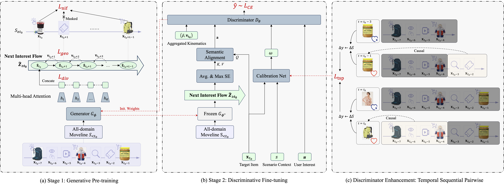

# 候选相关兴趣如何随历史演化：局部监督与注意力更新门

历史中连续出现的行为未必属于同一种兴趣。用户在电脑配件之间插入服装浏览，预测保护壳点击时，既需要较早的配件信息，也要防止中间服装行为过度改写相关状态。问题不仅是“最后关注哪些行为”，还包括“每一步学到什么状态，状态更新如何随候选改变”。

[DIEN精读](../../来源/SRC-DIEN/阅读笔记.md)给出两层结构：第一层从时间有序行为提取兴趣序列，并用下一行为增加局部监督；第二层根据目标物品控制兴趣状态的递推。它是给定候选的CTR预测模型，不能仅因有行为序列就与所有下一物品推荐方法直接比较效果。

## 先区分候选聚合与候选递推

DIN令$v_U(A)=\sum_j a(e_j,v_A)e_j$，相同历史面对不同广告得到不同表示。与归一化注意力不同，其权重不做Softmax，以保留相关行为累积强度。它没有DIEN第一层的下一行为辅助监督，也没有AUGRU对历史状态逐步改写；两者增加了不同归纳偏置。[DIN§4.3、式(3)，PDF第4–5页](https://arxiv.org/pdf/1706.06978v4#page=4)。

DIN的mini-batch aware正则近似batch内出现次数为0/1，减少全嵌入表正则计算，并非普遍严格等价或无偏估计。Dice用batch分布调整激活，这两项训练技术与候选聚合的收益应分开：Alibaba表5基础0.5970、DIN0.6029、完整DIN+MBA+Dice0.6083；总增量不能全部归给注意力。AUC为按曝光数加权的用户内AUC，RelaImpr基于AUC−0.5，不是CTR增幅。[DIN精读](../../来源/SRC-DIN/阅读笔记.md#先对齐auc口径再解读组件和线上收益)。

## 下一行为可以是辅助信号

设第一层GRU由行为嵌入 $e_t$和上一状态形成 $h_t$。只有最终点击损失时，中间状态也有反向传播梯度，但缺少逐时间步的直接目标。DIEN让 $h_t$区分下一真实行为 $e_{t+1}$与负物品 $e^-_{t+1}$，再与主任务联合：

$$
L=L_{CTR}+\alpha L_{aux},\qquad
\ell_{aux,t}=-\log q_\theta(h_t,e_{t+1})
-\log\bigl(1-q_\theta(h_t,e^-_{t+1})\bigr).
$$

$q_\theta\in(0,1)$表示标量匹配概率；这是根据原文正负监督说明整理的表达。原式(6)及其Sigmoid定义存在求和/标量定义歧义，本轮未用代码确认具体打分器，详见[笔记中的原式边界](../../来源/SRC-DIEN/阅读笔记.md#为什么给历史隐状态增加下一行为监督)。公开辅助负例来自该步点击商品以外，工业辅助负例为曝光未点击广告；不能将二者视为同一分布，也不能据此补全主任务采样。[DIEN方法节·Interest Extractor Layer，PDF第3–4页](https://arxiv.org/pdf/1809.03672v5#page=3)，[辅助实验，PDF第6页](https://arxiv.org/pdf/1809.03672v5#page=6)。

局部监督帮助状态学习可预测的行为信息，并给嵌入增加训练信号；它不证明学到了真实心理兴趣。若历史来自全平台而主目标只在一个广告场景，辅助任务与主目标可能不同；损失权重、负例和历史窗口都属于需要比较的条件。

## 候选注意力改变的是更新路径

令目标广告嵌入为 $e_a$，按列向量统一原式(8)：

$$
a_t=\operatorname{softmax}_t(h_t^\top W e_a),\qquad
\bar u_t=a_tu'_t,\qquad
s_t=(1-\bar u_t)\odot s_{t-1}+\bar u_t\odot\widetilde s_t.
$$

$W$将广告与第一层隐状态联系起来，Softmax在有效历史位置上归一化；$u'_t$是第二层GRU的逐维更新门，$\widetilde s_t$是待写入状态，二者由 $h_t,s_{t-1}$计算。$a_t$小的时候，状态接近沿旧状态传递，保留了较早相关信息。权重依赖目标广告，所以相同历史对不同候选会产生不同的 $s_T$。[DIEN式(8)、(11)–(12)，PDF第5页](https://arxiv.org/pdf/1809.03672v5#page=5)。

只把输入缩为 $a_th_t$的AIGRU无法保证状态不变：即便输入为零，旧状态、偏置和门仍可导致更新。AGRU直接以 $a_t$替换整个门，虽能控制写入，却丢掉逐维差异。AUGRU将标量与原门相乘，保留两种信息。这里的“保留”是连续加权，通常没有跳过时间步、删除行为或稀疏执行；小注意力也不等于无成本。[DIEN式(9)–(12)，PDF第5页](https://arxiv.org/pdf/1809.03672v5#page=5)。

最终 $s_T$与广告、用户画像、上下文嵌入拼接送入MLP，产生点击概率。第一层序列不依赖目标，结构上可以复用；第二层注意力与递推按候选计算，无法只缓存一个用户向量就等价恢复所有分数。固定宽度下，两层都有时间步串行依赖，第二层工作量随候选数和历史长度增加；批处理与kernel融合能改善运行效率，但没有消除这些依赖。

## 先比较候选在哪一步参与，再比较效果

| 方法 | 历史表示与监督 | 候选何时参与 | 接口和代价 |
|---|---|---|---|
| DIN | 历史嵌入直接候选加权求和，CTR主损失 | 候选进入局部激活单元；权重不做Softmax归一化 | 逐候选聚合；不显式表达历史顺序 |
| DIEN | GRU兴趣序列有下一行为辅助目标；最终CTR为主任务 | 每个候选决定第二层注意力与AUGRU演化 | 第一层可复用，第二层按候选递推，适合候选CTR打分 |
| SASRec | 因果自注意力编码历史；逐位置预测下一物品 | 末端用候选嵌入与状态内积 | 同一历史状态可为多候选复用；历史注意力仍含窗口二次成本 |
| MIND | 对历史嵌入路由得到多个兴趣，按目标选兴趣并用sampled softmax训练 | 训练按目标选择兴趣；服务保留多个独立检索向量 | 多路ANN召回；原模型未显式表达时间顺序，不能直接替代兴趣演化 |

SASRec机制与101候选评估见[下一物品问题](从历史顺序预测下一物品.md)及[原式(6)，PDF第4页](https://arxiv.org/pdf/1808.09781v1#page=4)；MIND训练目标与服务差异见[多兴趣检索问题](单向量如何保留多个兴趣并支持检索.md)及[原文Label-aware Attention，PDF第5页](https://arxiv.org/pdf/1904.08030v1#page=5)。这张表比较结构、监督与接口，不把各论文不同任务的指标作排名。DIN已补读[固定v4原文](../../来源/SRC-DIN/阅读笔记.md)，其局部激活与DIEN的候选递推分别核实。

[SIM的长历史检索](长历史怎样在候选条件下压缩计算.md)改变精细网络看到的行为集合，DIEN改变给定序列上的状态更新；SIM原图1保留短期DIEN，二者可以组合。SIM软检索辅助头预测当前候选点击，与DIEN下一行为监督的标签对象不同。[SIM图1及式(2)、(5)，PDF第3–4页](https://arxiv.org/pdf/2006.05639v2#page=3)。

## 先预测未来连续状态再让候选读取

DIN与DIEN都在已经发生的历史上形成候选相关表示。[AMEN精读](../../来源/SRC-AMEN/阅读笔记.md)增加一段候选无关的未来推演：生成器先根据真实历史和此前预测的向量，自回归产生 $\hat Z\in\mathbb R^{L\times D}$；训练时用真实未来物品与负例的InfoNCE监督每一步。线上拿到的是预测状态，不是未来真实行为，也不是已经映射到在售物品的ID。

*作者原图1，2510.11317v2 PDF第2页，Chen Gao等；与精读复用同一源码原图文件。左侧是连续状态预训练，中间是冻结生成器后的候选对齐，右侧是时间异标签配对。*

阶段2令当前候选 $c$ 查询预测轨迹：$a=\operatorname{Attention}(c,\hat Z,\hat Z)$，再与历史表示、平均头多样性、首步状态差分和候选一起送入CTR网络。候选选择的是预测未来的状态；DIEN则让候选改变历史上的递推路径。AMEN的生成器固定，因此CTR梯度训练对齐模块与判别侧，不回传更新生成器。原文以判别基座初始化生成器，不是明确报告生成预训练后再将整套权重回灌判别器。[AMEN§2.1–2.2、式(1)–(7)，PDF第2–3页](https://arxiv.org/pdf/2510.11317v2#page=2)。

| 需要区分的计算 | DIN / DIEN | AMEN |
|---|---|---|
| 被候选读取的对象 | 真实历史嵌入 / 历史提取状态 | 由历史推演的未来连续状态，另保留历史表示 |
| 辅助信号 | DIEN区分下一真实行为与负例，服务当前CTR | 阶段1逐未来步InfoNCE；阶段2另有异标签成对校准 |
| 对候选的依赖 | DIN逐候选聚合，DIEN第二层逐候选递推 | 生成轨迹候选无关；对齐与CTR逐候选计算 |
| 最终输出 | 已知候选的点击概率 | 同样是已知候选的点击概率，不直接输出商品码 |

多头Gram趋于单位阵的正则限制头间数值相关；二阶差分正则限制速度变化，未计算真实流形度量。不能由头正交推出语义独立，或把二阶平滑等同于已证明的测地线。TSP在同动线时间窗内把异标签样本的校准分数按正负排序，属于观察数据监督，时间先后本身不识别干预因果。具体数学条件与算例见[正则解释](../../来源/SRC-AMEN/阅读笔记.md#两种正则分别限制头的相似性和轨迹弯折)和[时间配对](../../来源/SRC-AMEN/阅读笔记.md#时间成对监督怎样改变校准分数)。

工业表1中MEDN为0.7621、完整AMEN为0.7708，而去除NIF为0.7694；完整相对MEDN高0.87个百分点，加入NIF相对无NIF高0.14个百分点，二者不能混写。线上Feeds的CTCVR +11.6%是无NIF判别增强相对MEDN；完整相对无NIF另报 +2.28%，表中未完整重述相同场景口径，不直接连乘。P5/TIGER的CTR适配和预算缺报，不能由本表宣判连续生成对所有离散生成的普遍优势。[AMEN表1–2，PDF第4–5页](https://arxiv.org/pdf/2510.11317v2#page=4)。

## 先生成兴趣文本再约束检索

[User Personas精读](../../来源/SRC-USER-PERSONAS/阅读笔记.md)把生成结果改为可读的概括兴趣和相关探索主题。教师用显著词语义簇组织历史，多次生成概括、探索及理由；学生学习统一提示，一次推理生成双任务回复。线上明确采用音视Embedding簇和视频标题，不能把教师数据和线上输入配置混同。原文未给实际loss、mask和参数更新范围，文本监督的常规解释不冒充实现。[§4.1、§5.4.1，固定v2 PDF第3–4、6页](https://arxiv.org/pdf/2606.12198v2#page=3)。

画像缺失或陈旧时后台重建，当前请求不等LLM；后续请求读新缓存。每请求均匀随机取一个概括兴趣和一个探索兴趣，文本限制可检索视频集合，再由序列Transformer的用户—物品匹配执行受限最近邻搜索，最后交下游排序。文本到约束集合的构造/阈值未披露。与AMEN相比，本篇产生文本条件，AMEN产生供候选CTR读取的连续预测状态；与DIEN相比，本篇新增候选发现入口，DIEN主要改变已知候选的历史状态更新。[§3.1、§4.2、§5.4.1，PDF第3–4、6页](https://arxiv.org/pdf/2606.12198v2#page=3)。

| 比较维度 | DIEN | AMEN | User Personas |
|---|---|---|---|
| 主要中间对象 | 真实历史提取状态 | 预测的未来连续状态 | 概括/探索自然语言及理由 |
| 候选与兴趣的关系 | 候选控制历史递推 | 候选读取预测轨迹 | 文本先约束候选检索，再排序 |
| 服务复用 | 首层状态可复用，第二层候选相关 | 轨迹候选无关，对齐逐候选 | 画像跨请求缓存，刷新有滞后 |
| 直接训练证据 | 下一行为辅助＋当前点击 | 未来对比监督＋CTR/时间配对 | 教师合成回复微调；实际loss缺报 |

User Personas的输入比较以用户点击主题作BLEURT参考，蒸馏比较改用教师概括，不能把两套分数当用户准确率。>30天A/B报告观看时长+0.04%、活跃用户+0.03%等相对增量，支持整套接入；探索候选在已曝光条件下观看概率高13.6%，经过排序选择，不能独立识别探索的因果优势。平台十亿用户不是实验人数，TTL、量化位宽、QPS和P95缺报，不能拿质量分数代替服务成本对照。[§5.1–5.4，PDF第5–7页](https://arxiv.org/pdf/2606.12198v2#page=5)。

## 组件收益与业务收益应分别核对

DIEN表4中，Electronics/Books的两层GRU后注意力AUC为0.7605/0.7890，GRU+AUGRU无辅助损失为0.7640/0.7911，加入辅助损失的DIEN为0.7792/0.8453。它们说明在该协议下，门与局部监督分别提供增量；不能把全部收益归给AUGRU。公开实验报告5次均值和标准差，完整切分、主任务负采样与搜索预算未给出。工业表3从无辅助0.6493到完整DIEN 0.6541，任务和数据不同，不能和公开差值直接解释为因果异质性。[DIEN表2–4，PDF第6页](https://arxiv.org/pdf/1809.03672v5#page=6)。

线上2018年6–7月A/B的CTR +20.7%、PPC −3.0%、eCPM +17.1%均相对BaseModel，不是相对DIN，也不是百分点；未给完整随机化与置信区间。服务38.2→6.6 ms是融合、批处理与轻量化组合后的作者报告，单worker为360 QPS，硬件和时延分位数未明。[DIEN表5及服务段，PDF第7页](https://arxiv.org/pdf/1809.03672v5#page=7)。选型时需同时对齐监督、候选数、历史长度与资源，离线AUC、线上业务收益和系统吞吐分别评估。

## 结构化记忆只用增量维护，再交给意图规划

[RecGPT-V3](../../来源/SRC-RECGPT-V3/阅读笔记.md#长期记忆是结构化数据不是模型权重里的永久知识)把历史保存为多个可追溯的记忆单元，每单元包含模式ID、摘要、代表行为索引、品牌和时间信息。初始化读取全历史；维护时只读旧记忆与新行为，相关单元重写，无新证据就保留，未匹配行为才可能形成新单元。两项操作合为一次LLM调用，生产每两个月维护，规划器在两次维护间仍可读取近期增量。[固定v2 §2、式(1)–(7)，PDF第5–8页](https://arxiv.org/pdf/2607.15591v2#page=5)。

例如旧记忆是羽毛球拍偏好，新Astrox浏览更新该单元，连续跑步行为可新建另一单元；它不要求每次重新分析全部球拍历史。这是可编辑的数据状态，不能写成模型权重在线记忆，也没有已披露的显式删除/遗忘、容量和冲突恢复算法。行为索引能追查摘要根据，不能独立证明推断是真实心理偏好。

| 生成/维护对象 | 候选何时进入 | 后续接口与监督 |
|---|---|---|
| AMEN未来连续轨迹 | 轨迹生成后由候选注意力读取 | 未来真实行为对比预训练，冻结后CTR判别 |
| User Personas概括/探索文本 | 文本先约束既有序列检索 | 异步缓存画像，教师蒸馏的学生loss细节不足 |
| RecGPT结构记忆 | 记忆维护与规划不以某个待评分商品为输入 | 规划专家生成文本/SID，再检索排序；维护函数本身未给独立训练目标 |

三者分别预测连续状态、生成检索条件和维护可复用记忆。RecGPT的82.89%模式准确率与95.27%行为索引准确率评价不同标注对象，不能拿来和AMEN的AUC或Personas的线上CTR直接排名；成本分母见[服务效率](../模块/在线服务、更新与计算效率.md#记忆维护和潜推理分别改变服务成本的哪一项)。
