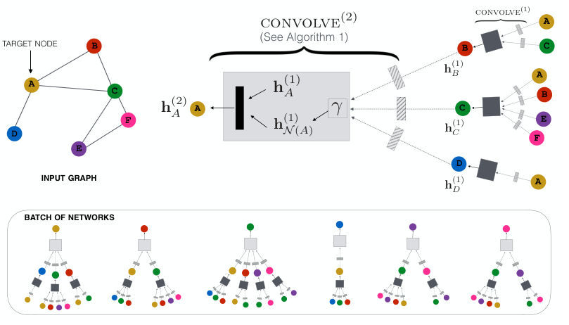

# 利用交互图传播协同表示：从独立向量到多阶邻居共享

用户自己的行为稀疏时，其他具有共同交互的用户可提供协同线索。BPR-MF 通过正负物品对学习独立的用户与物品向量；LightGCN 则把交互图放进打分器，使最终向量显式融合多阶邻居。二者都可用成对排序监督，区别是**监督之下怎样共享参数与表示**，不能把 LightGCN 当作另一种 BPR 损失。

## 相对监督与表示结构分别决定什么

设用户向量为 $p_u$、物品向量为 $q_i$。BPR-MF 以 $s(u,i)=p_u^\top q_i$ 打分，对已观测 $i$、未观测 $j$ 优化 $\log\sigma(s(u,i)-s(u,j))$，加参数正则。正负对产生相对偏好约束，不能确认用户确实看见过负例。相同用户和物品参数被不同样本共同更新，形成隐式协同共享，但预测时不显式聚合邻居。[BPR-MF机制与梯度](../../来源/SRC-BPR/阅读笔记.md#同一准则怎样作用于两种模型)，[BPR §4.3.1，PDF第6页](https://arxiv.org/pdf/1205.2618v1#page=6)。

LightGCN 保持正负分差目标，把向量换成下面的图传播结果。它的变化在打分器及梯度传播路径。BPR 的抽样权重、未知不等于负偏好的限制仍需考虑，不能因为加了图就认为解决了曝光偏差；详见[隐式反馈的相对偏好学习](隐式反馈的相对偏好学习.md)。

## 用二部图把共同交互变成传播路径

令训练交互矩阵为 $R$，用户与物品初始向量合为 $E^{(0)}$，定义：

$$
A=\begin{pmatrix}0&R\\R^\top&0\end{pmatrix},\quad
D_{aa}=\sum_bA_{ab},\quad
\widetilde A=D^{-1/2}AD^{-1/2},\quad
E^{(k+1)}=\widetilde A E^{(k)}.
$$

$D$ 是节点度矩阵。等价地，用户聚合每个邻居物品的权重为 $1/\sqrt{|\mathcal N_u||\mathcal N_i|}$。传播没有特征变换矩阵、激活和单步自连接，仅初始 ID 向量可训练。经过 $K$ 层后：

$$
E=\sum_{k=0}^{K}\alpha_k E^{(k)},\qquad
\widehat y_{ui}=e_u^\top e_i.
$$

$\alpha_k$ 是非负层权重，默认均匀 $1/(K+1)$。第0层保留自身表示，一层加入交互对象，二层加入有共同交互的同类节点。以三元组损失 $-\log\sigma(\widehat y_{ui}-\widehat y_{uj})$ 训练，正则施加在 $E^{(0)}$；实际小批量抽样分布未从该篇正文完整核实，不能假定与原始 LearnBPR 完全相同。[LightGCN的完整机制](../../来源/SRC-LIGHTGCN/阅读笔记.md#从独立-id-参数到交互图上的共享)，[§3.1–3.3、式(3)–(8)及(15)，PDF第4–6页](https://arxiv.org/pdf/2002.02126v4#page=4)。

两跳用户传播的系数为：

$$
c_{v\to u}=\frac{1}{\sqrt{|\mathcal N_u||\mathcal N_v|}}
\sum_{i\in\mathcal N_u\cap\mathcal N_v}\frac{1}{|\mathcal N_i|}.
$$

因此，在其余条件固定时，共同物品越多、越冷门，邻居用户越不活跃，单条协同联系影响越大。这个公式解释了“为什么平滑可能有帮助”，也说明它不是无区别地平均全部用户，更没有利用物品文本语义。[LightGCN §3.2.3、式(13)–(14)，PDF第5页](https://arxiv.org/pdf/2002.02126v4#page=5)。

## 同一类损失下，两种解法的取舍

| 维度 | BPR-MF | LightGCN |
|---|---|---|
| 输入与共享 | 用户/物品ID，样本共同更新参数 | 同类ID再加交互图，预测向量显式融合邻居 |
| 可训练参数 | 用户/物品向量 | 第0层用户/物品向量；默认层权重固定 |
| 单次学习影响 | 一个三元组主要影响相关向量 | 梯度经多层传播影响邻域初始向量 |
| 训练计算 | 数据梯度按三元组约 $O(d)$ | 一次全图传播约 $O(K|\mathcal E|d)$，另有小批量打分与反向 |
| 预测接口 | 用户与物品向量内积 | 可先缓存最终向量，再作内积；图变化后需重算受影响表示 |
| 已核实证据 | Rossmann/Netflix子集、随机留一、AUC | Gowalla/Yelp2018/Amazon-Book、全库排序、Recall/NDCG@20 |

复杂度是由公式分析的量级，$d$ 为维度，$\mathcal E$ 为交互边；两列描述的计算单元不同，不能直接把它们相除声称提速。相同参数量不等于相同训练、显存或更新成本。两篇原论文的数据和协议不一致，不能据数值判定 LightGCN 比原始 BPR-MF 提高多少；LightGCN 对部分旧基线沿用 NGCF 结果，也不是本库重新实现的公平实验。[BPR证据范围](../../来源/SRC-BPR/阅读笔记.md#实验支持的是目标选择而非更复杂的网络)；[LightGCN实验与成本](../../来源/SRC-LIGHTGCN/阅读笔记.md#全库离线结果与层数归一化的取舍)。

## 简化成立的范围与过平滑边界

LightGCN 针对纯 ID 协同过滤。其 NGCF 消融显示，移除特征变换明显改善所列数据的效果，单独去激活影响较小，同时移除更好；这些变体沿用 NGCF 最优超参数，不能概括成所有富属性图上非线性都无用。[§2.2、表1和图1，PDF第2–3页](https://arxiv.org/pdf/2002.02126v4#page=2)。

保留各层表示缓解“只取末层”的过平滑，但默认均匀权重不是普遍最优：Amazon-Book/Yelp2018 的两层 single 曾更好，增加层数也不保证所有指标单调提高。作者把层组合与 SGCN 自连接、APPNP 重启联系起来；SGCN 二项式推导省略了度归一化，APPNP 展开要求同一传播算子与特定非均匀系数，均不能证明默认模型无限加深仍安全。推导与条件见[层组合的等价边界](../../来源/SRC-LIGHTGCN/阅读笔记.md#层组合与自连接有条件的关系不是默认模型严格等价)、[原文§3.2.1–3.2.2，PDF第5页](https://arxiv.org/pdf/2002.02126v4#page=5)。

归一化同样需要看数据：表5双侧平方根总体较好，但 Amazon-Book 的左侧 $L_1$ 结果更好。表3/4/5的部分数字存在不一致，平滑度量式(17)与尺度不变的文字说明也有疑点，见[精读核对](../../来源/SRC-LIGHTGCN/阅读笔记.md#全库离线结果与层数归一化的取舍)。不依赖这些疑点来断言唯一最优归一化或平滑是全部收益的原因。

## 从全图纯 ID 传播到带属性的采样卷积

换成 Pin–Board 图，同两张耳机图片可能被多人收藏到相同看板，但各看板的规模、主题和与种子的接近程度不同。PinSage 用短游走把多步共现转成邻域权重，只保留访问次数最高的 $T$ 个邻居。若从种子耳机出发的游走到达 $A,D$ 各 8 次、2 次，归一化权重为 0.8、0.2。共享变换先把邻居状态映射到同一空间，再按该权重求均值。拼接种子自身内容，经新一层变换和归一化得到本层表示。LightGCN 用交互图的度和边决定每步传播，PinSage 用有种子条件的访问分布决定邻域和分量。[PinSage §3.2](../../来源/SRC-PINSAGE/阅读笔记.md#访问频率先决定邻居再决定每个邻居的分量)

Ying 等作者原图 1，arXiv 1806.01973v1，第 2 页。先从目标向后找上一层依赖，再从属性向前计算。训练在小批图上做梯度更新，大批推理时用 MapReduce 逐层复用中间表示。

PinSage 的正对来自共同参与的相关 Pin，训练用分差铰链损失，并从个性化 PageRank 名次中渐进加入难负例。LightGCN 的监督是用户与已交互、未观测物品的 BPR 分差，训练在用户–物品二部图传播。PinSage 学到的变换可对有属性和可用邻域的新物品编码，服务查已生成的物品向量。历史回放中应先按训练时点冻结互动边、看板成员关系和采样关系。若将留作评价的收藏加入构图，邻域与难负例会受到未来信息影响。[PinSage §3.3–3.5](../../来源/SRC-PINSAGE/阅读笔记.md#批量建索引时按节点复用而服务不用重跑图)

PinSage 的池化对照使用 500 万 Pin 测试池、Hit@500 和缩放 MRR。LightGCN 以全库 Recall/NDCG@20 对公开协同过滤数据验证。物品到物品和用户到物品各由不同的查询、标签及候选池定义。内容属性和共享变换为新物品提供入口，实际零交互收益还取决于当时可用属性和建索引延迟。

## 表示与检索服务的接口

训练后的内积接口适合连接[向量召回](../模块/召回与检索.md)，但全库离线打分不自动给出 ANN 的近似损失、索引更新延迟或在线收益；原文也未验证内容冷启动。与[语义短码检索](用语义短码直接检索物品.md)相比，这里学习的是交互图上的连续表示，不是将内容量化为可生成标识。先判断需要哪种信号和输出，再比较计算及更新预算；不要因为二者都叫“推荐检索”就横比不同协议的数字。
