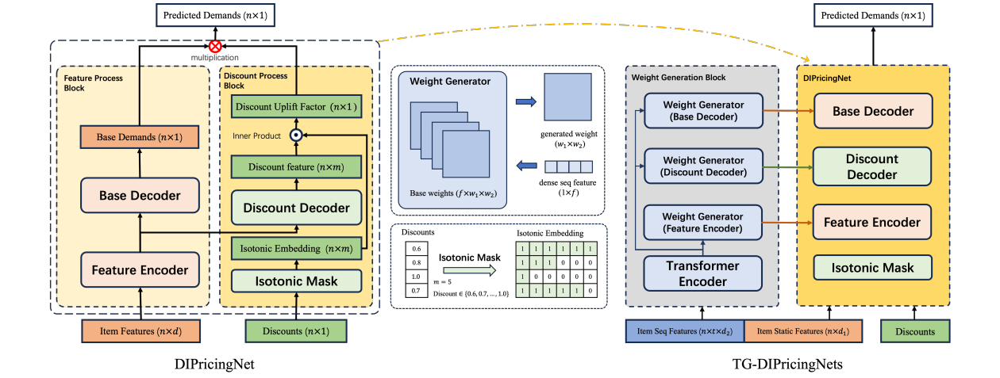
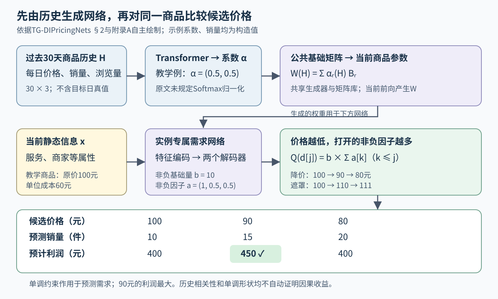

# 商品历史如何生成单调需求曲线并支持定价

定价系统需要知道一件商品在若干候选价格下会卖多少，再把销量和毛利、库存或预算组合成决策。难点在于商品间销量规模和价格敏感性差异很大，而每件商品拥有的调价记录又很有限。共享固定参数能借用全体数据，商品独立模型更灵活，但容易缺样本；历史生成参数则在共享基础矩阵上学习条件化计算。

这属于营销中的价格响应建模，放在[因果与Uplift模块](../模块/因果推断与Uplift预估.md)作预测和因果识别的边界案例。TG-DIPricingNets提供的是观测数据训练的销量响应网络，不能仅凭单调性将它归为已识别因果效应的模型。论文细节、贯穿算例和疑点见[正式版精读](../../来源/SRC-TG-DIPN/阅读笔记.md)。

## 先预测整条曲线，再按业务口径决策

固定商品历史 $H$和静态信息 $x$，模型输出 $\hat Q(d\mid H,x)$。倍率 $d$与原价 $P$相乘得到成交价；倍率减小才是降价。给定每件成本 $c$，TG论文使用

$$
d^*=\arg\max_{d\in\mathcal D}\hat Q(d\mid H,x)(Pd-c).
$$

这是短期单商品毛利目标，来源于正式版§2.1式(1)。离散候选可直接比较，需求单调不要求利润单峰；因此不应在未证明凹性时改用单峰搜索。库存、平台分摊、退款和跨商品替代需要另定义目标及约束。

历史价格由旧策略选择，观测预测 $\mathbb E[Y\mid H,x,d]$要作为干预均值 $\mathbb E[Y(d)\mid H,x]$使用，还需一致性、给定干预前信息的可交换性和价格支持等条件。商品潜在热度可能同时导致提价和销量增加；历史浏览量能提供状态信息，但不自动排除所有混杂。候选档即使能算出预测，也不说明该档有足够证据。

## 累计非负因子提供方向约束

这里的“单调嵌入”是把有顺序的价格档映射为累计二元编码，例如100、90、80元分别编码为 $(1,0,0)$、$(1,1,0)$、$(1,1,1)$；规则固定，模型学习每个位置的非负贡献。保证方向的是这种编码与非负加权的组合，而非任意可学习的Embedding向量。

把候选倍率由高到低排列 $d_1>\cdots>d_m$。模型输出非负基础量 $b(H,x)$、非负因子 $a_k(H,x)$，用前缀遮罩累计：

$$
\hat Q(d_j)=b\sum_{k\le j}a_k,\qquad
\hat Q(d_{j+1})-\hat Q(d_j)=ba_{j+1}\ge0.
$$

这是DIPricingNet的结构化展开，依据§2.2与图1。控制方向的是输出非负和遮罩逐元素嵌套，不能只数1的个数：旧位置必须保留，才不会移除较大的已学贡献。内部权重无需全部非负；同一次候选比较必须固定商品状态与生成的参数。不同日期/人群的曲线不能直接套用此不等式。输出“基础量”也不必然等于无折扣需求，锚定需要额外归一化或首因子约定，本篇未说明。

这样能排除某些不合方向的插值，却仍可能得到完全错误的单调曲线。缺少价格探索时有许多曲线同样拟合事实点，形状约束不能选择出唯一真实因果曲线。

累计结构还需说明输出尺度：DIPN原论文v1§4.1–4.2的二分类版本累加非负logit增量，加基础logit后经sigmoid输出概率；本篇DIPricingNet则用基础需求乘累计非负因子，$ba_j$是相邻销量增量，也可从第一档预测销量出发逐档累加。原式、局部近似与算例见[精读中的尺度比较](../../来源/SRC-TG-DIPN/阅读笔记.md#相邻增量累加累加的是哪个尺度)。

## 固定参数、历史拼接和生成权重的区别

Longxiang Zhang等，ACM正式版第2页图1；从固定PDF裁出完整架构区域，图内内容未改。左侧是固定网络，右侧由历史Transformer生成三个模块的权重，中间说明矩阵组合与遮罩。此图没有画历史拼接对照；三种接口的比较见下表，原图符号与逐步解释见[论文精读](../../来源/SRC-TG-DIPN/阅读笔记.md#固定需求网络如何把价格单调性写进计算)。

| 方案 | 历史怎样作用 | 共享与代价 | 当前证据范围 |
|---|---|---|---|
| 固定DIPricingNet | 用固定网络处理商品特征，具体历史汇总披露不足 | 全局共享，简单；异质性需由输入和网络容量表达 | TG论文内部基线 |
| Transformer历史拼接 | $[T(H),x]$进入固定下游网络 | 保留动态历史表示；非线性下游本身可建交互 | TG论文内部对照 |
| TG历史生成参数 | $\alpha=T(H)$，$W(H)=\sum_r\alpha_r B_r$，再处理 $x$ | 基础矩阵共享、当前权重条件化；生成参数和矩阵库增加计算/存储 | TG正式版§2.3、附录A和表1 |

第三种可以看作一种条件参数生成或超网络结构：共享生成器给另一个网络产生参数。但它不是逐Token语言生成，不需要把每个权重当成词来解码。基础矩阵数 $n$固定时，$W(H)$局限于其张成空间；这提供共享约束，也限制个性化容量。论文没有给出 $n$、归一化、所有层与偏置的处理，不能把系数解释成概率或宣称完整复现所需配置已知。

上排历史生成的是网络参数，下排静态特征由这些参数变换，候选价格只改变遮罩。图中三个教学价格的需求依次10、15、20，利润400、450、400元，90元最优；这是说明计算顺序的构造值，不是作者模型输出。

生成权重的一层可展开为 $\hat y=\sum_r\alpha_r(H)x^\top B_r$，历史系数与静态特征显式相乘。固定加性读出 $a^\top T(H)+b^\top x$没有这一混合项，但其损失残差仍依赖两路输入；非线性拼接更可以学习交互。因而应比较交互参数化与归纳偏置，而不是宣称拼接模型“无法交互”。维度一致的梯度和原附录缺项见[精读推导](../../来源/SRC-TG-DIPN/阅读笔记.md#参数生成引入的乘性交互与正确梯度)。

## 曲线标签和指标决定验证能回答什么

普通销售日志只有实际价格下的销量，不能直接提供所有候选价格的真值。训练需要说明事实位置损失、曲线结构共享、探索覆盖或反事实识别中的哪一部分承担了泛化。TG论文只给抽象 $L(\hat Y,Y)$，未披露完整损失、零销量或未观测价格标签构造；不能把教学用事实点平方损失当成作者方法。

其DWMAPE先按真实销量分组，计算组内WMAPE，再按商品数加权。它让尾部组的相对误差得到更多权重，却不自动符合利润目标，也不消除混杂；零组分母和分段需显式约定。正式版表1报告70.60% → 69.00% → 66.70%，完整结构比固定基线降低3.90个百分点。这里缺少等容量、多seed、切分和资源协议，不能据主表把提升唯一归因于某一机制。

利润验证更要区分策略收益。正式版§3.2将历史订单按“实际价格距模型建议多远”分组，平均利润6.48/7.13/6.73元；5.94%来自 $7.13/6.73-1$。模型建议接近组的利润较高，不等于把其余组调价后能获得同样提升。需要实际策略干预或具有相应识别条件的离策略评估。[数据、公式与证据核对](../../来源/SRC-TG-DIPN/阅读笔记.md#实验支持什么预测改善明确利润因果收益未建立)。

## 与联合优惠和正交Uplift的分工

[TaQFormer](../../来源/SRC-TAQFORMER/阅读笔记.md)把多个优惠坐标保留为处理Token，查询共享请求记忆，预测完整动作下的绝对响应概率；先用观察数据学表示，再在随机数据上适配。它适合联合优惠动作表与请求级分配，强调全动作计算复用，并没有在本库已核实范围内提供TG那样的价格单调保证。

[POUL](../../来源/SRC-POUL/阅读笔记.md)将策略定义为场景—动作概率混合，使用联合原子表示和残差化，输出相对对照的条件效应。它解决策略组件共享和效应学习，不能凭正交性消除所有表示误差，也没有TG的商品价格曲线与毛利枚举。完整策略比较见[组合营销问题](组合营销策略如何共享结构并估计因果增量.md)。

三者的输出单位、处理对象和证据协议不同：销量曲线可以算毛利，响应概率可以接每单贡献和补贴率，因果增量可以接相对对照的净价值与成本。迁移时须先固定实际目标，再选结构，不按“都有Transformer/优惠”互相替代，也不跨论文比较DWMAPE、Qini和AUUC数值。

若平台承担补贴 $s$、净到手价为 $P-s$，简化的价值接口可写为 $\Delta V(s)=V(s)-V(0)$，并单独约束预计支出；成本取决于补贴按曝光、下单还是核销支付，是否由商家分担。该接口是业务问题定义，不是TG已给出的补贴算法；它与[预算约束](../总览/营销补贴总图.md#从增量预估走向预算决策)衔接。

## 采用前最小可检验条件

先确认调价发生前可用的历史与静态状态，保留足够价格变化和日志概率，区分商品日销量与订单利润口径。按时间切分并检查重复商品和窗口泄漏，在相同容量/算力下比较固定、拼接、生成权重模型；除总体预测误差，还要看不同销量组、价格支持范围和利润敏感区间。最后用可执行约束下的策略实验验证净价值，避免只靠建议接近程度分组。

历史足够、量价关系异质、候选可枚举时，TG的结构值得作为候选；冷启动、极少调价、跨品替代、动态曝光和长期囤货等条件需要单独验证。当前依据为原文静态阅读和算例核对，未运行模型或线上策略；不能把本页作为上线效果承诺。
