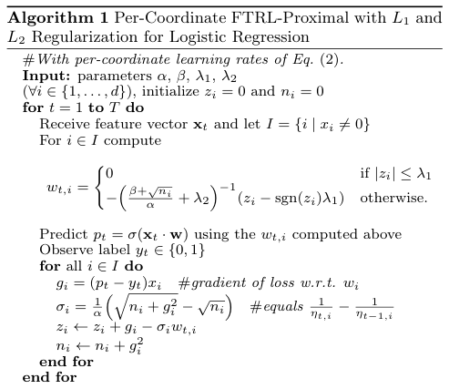

# 在线 CTR 怎样得到稀疏权重

一条曝光带来上下文 $x$ 和随后的点击标签 $y$。线性 logit $w^\top x$ 可以读少数非零特征，快速预测及更新。模型体积取决于有多少非零系数能随版本部署到服务。FTRL-Proximal 在训练期保存数据梯度的状态，并在预测读出时通过 L1 的近端阈值让部分系数精确为零。

## 权重由两个状态读出

记 $n_i=\sum g_{s,i}^2$，$z_i=\sum(g_{s,i}-\sigma_{s,i}w_{s,i})$，其中 $g_{s,i}$ 是第 $s$ 次点击损失在坐标 $i$ 上的梯度，$\sigma_{s,i}$ 为相邻逆学习率之差。每个活动坐标求解
$$
\min_{w_i} z_iw_i+\frac12\left(\frac{\beta+\sqrt{n_i}}{\alpha}+\lambda_2\right)w_i^2+\lambda_1|w_i|.
$$
若 $|z_i|\le\lambda_1$，零点处绝对值项的次梯度能抵消线性项，故最优点为 0。超过阈值则用软阈值 $z_i-\operatorname{sgn}(z_i)\lambda_1$ 除以负的二次曲率。平方梯度和较大的坐标随数据积累更快减小步长。阈值会改变活动坐标，L2 会改变越过阈值后的收缩比例。只有零权重可在部署表示中省略，训练期统计量持续记录已纳入特征。原论文还通过概率纳入特征、定点数和多模型共享统计来降低训练内存。[FTRL-Proximal 逐曝光算例及算法 1](../../来源/SRC-FTRL/阅读笔记.md#一次曝光怎样更新两个状态)

McMahan 等作者算法 1，KDD 2013 第 2 页。依次核对阈值、预测、梯度、逆步长差和写回，图中 $n,z$ 都是坐标级状态。

## 优化器、交叉表达与评估

对 ESPN、Nike、Male 的一次点击，线性 FTRL 更新当前特征。若手工额外加入 ESPN×Nike，它也获得自己的坐标和状态。下条曝光换成 Adidas，该交叉坐标没有梯度。FM 让变化通过 ESPN 向量共享给任何组合，FFM 让变化通过 ESPN 的广告主视角传给其他广告主。Wide & Deep 原论文的宽路采用带 L1 的 FTRL，深路用 AdaGrad，两个 logit 共同对安装标签拟合。类似的共享梯度也可以用其他优化器实现，表达由特征编码与模型结构决定。[低高阶交叉比较](稀疏特征的低高阶交互学习.md) · [Google Play 的联合更新](../../来源/SRC-WIDEDEEP/阅读笔记.md#应用安装标签训练输入与更新路径)

在线学习中，以当前参数先打新曝光，再更新能评估随流量变化的预测表现。模型对照应覆盖同一时间和人群，并分别检查非零权重、Logloss、AucLoss 及概率校准。FTRL 文中用 AucLoss $1-\mathrm{AUC}$、非零系数和逐坐标步长报告模型比较。如何在概率分桶上拟合单调映射，见[排序分数怎样校准为曝光点击概率](排序分数怎样校准为曝光点击概率.md)。训练下采样按查询抽取无点击请求，使用逆纳入率恢复损失贡献，其权重和校准层各自处理不同环节。[FTRL §3–7](../../来源/SRC-FTRL/阅读笔记.md#在线验证与概率校准如何接进生产系统)
