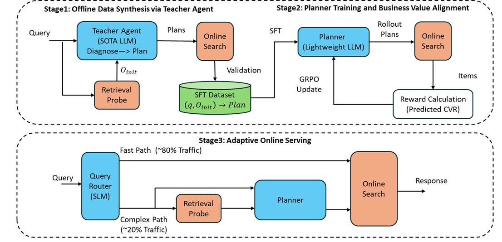

# 复杂查询怎样生成可执行的检索请求

用户搜“搭配绿色衬衫的下装”，可能需要修改核心检索实体，也可能需要扩展为多个裤装类别。是否应该改，取决于原查询已经命中了什么、后端认得哪些过滤条件、商品目录里有何供给。如果原结果已经解决需求，改写可能引入漂移。如果快照只召回了衬衫，将“下装”具体化为后端能正确召回的卡其裤和牛仔裤有机会提高覆盖，但仍需用原始搭配意图验证返回品。

## 用离线试搜预生成改写

“自制盲盒”能否改成“DIY 盲盒”，可以在与线上一致的倒排召回接口上先试搜。BEQUE 用语言模型生成多个候选，对每条改写实际召回的商品计算原意相关率、相对原查询的优质相关覆盖，以及场景外成交品的命中。改写的文本相似度和实际返回商品的相关性需要分别验证。例如基准只有 2 件相关优质品，改写后的并集达到 4 件，对应覆盖比 200%。如果改写召回 6 件但只有 4 件相关，它仍可能扩展覆盖，同时带入需要下游处理的噪声。原式的零基准计数和场景外命中分子适用范围见[BEQUE 的离线反馈](../../来源/SRC-BEQUE/阅读笔记.md#试搜结果怎样给改写排序)。

试搜发生在训练数据筛选和改写对齐时。上线前预生成中长尾改写并存成键值映射，命中请求同时用原查询和改写查询查倒排，两路并集送排序。收益依赖改写表覆盖、刷新与当前商品供给。其 14 天线上实验分别报告全桶和改写覆盖流量，后者的 GMV 分差不可外推至全部流量。[BEQUE 线上路径与结果](../../来源/SRC-BEQUE/阅读笔记.md#预生成的改写怎样接进线上搜索)

## 先观察失败发生在哪一步

通用词项改写将用户语言转换成检索可识别的目录用词。它适用于拼写与同义映射，却无法单靠查询辨别“搜不到是措辞问题，还是确实观测不到相应商品”。EASP 对被判为复杂的查询先调用轻量探针，把原查询和局部检索快照一起交给规划器。有效时保留原词，疑似词汇障碍时清洗，疑似供给空缺时停止继续改写，候选多却偏题时重设实体、属性或场景。快照只揭示这次探测可见的结果。判断供给空缺还会受到索引时效、探针能力和截断深度影响。[EASP 图 1 与计划实例](../../来源/SRC-EASP/阅读笔记.md#用同一个查询区分三种检索状态)

*作者原图 1 · 注意下半图的分支。快路径省去探针和规划，复杂路径先探测，再把计划交回同一搜索系统。Mengxiang Chen 等，arXiv:2603.15262v2 第 2 页。*

## 用原查询评价动作产生的候选

计划是否有用可以通过后端执行来检验。设 $\mathcal D_P$ 是执行计划 $P$ 后的 Top-$K$ 商品，$q$ 是原始查询。EASP 用线上已有模型预测相关性 $\phi_{\mathrm{rel}}$ 与转化率 $\phi_{\mathrm{cvr}}$：

$$
R(P)=\frac1K\sum_{d\in \mathcal D_P}
\mathbb I[\phi_{\mathrm{rel}}(q,d)\ge\tau]\phi_{\mathrm{cvr}}(q,d).
$$

相关性门控以 $q$ 为基准，未过阈值的候选贡献为零。这样可以比较措辞完全不同的计划，也能在计划增加高转化但偏题商品时降低其得分。只要相关性模型漏掉颜色、否定词或型号等约束，奖励仍可能偏好不满足原意的计划。针对多约束查询，应检查不同错误类型的通过率，并把相关性、下游预测 CVR、购买命中与真实实验收益分别报告。[EASP 式 (3) 与样本算例](../../来源/SRC-EASP/阅读笔记.md#先学可执行示范再优化执行结果)

## 对多项约束先扩大覆盖，再复核原意

“500–800 元、适合海滩婚礼、不要纯黑或大图案的男士亚麻西装”可以由多条较短请求共同发现候选。LEAPS 先保留核心商品，在训练时用其他属性的组合试搜，以验证器确认的相关率选择示范。若训练只看单路相关率，两条同义改写可以都得到高分，实际还在捞同一批商品。扩展器后续用固定召回预算 $N$ 内去重并经验证的相关商品数 $|I_r|$ 奖励整组查询，$R_{\mathrm{eff}}=|I_r|/N$。执行时，几条扩展请求分别向黑盒后端取货，原查询和多源商品字段进入验证器，才决定哪些商品保留。放松条件发生在找候选时，筛选时仍检查原始价格、颜色、材质和场景。[LEAPS 集合奖励和算例](../../来源/SRC-LEAPS/阅读笔记.md#用去重后的相关覆盖奖励一组改写) · [多源证据与筛选](../模块/搜索相关性判断与验证.md#q-evidence)

论文离线消融中，仅扩展器在 Top-20 上得到 0.48 精度、0.85 召回，加入验证后为 0.79、0.82。验证器提高精度，也会滤掉一部分原本可用的候选。无论奖励还是报告指标，都需要区分训练时使用的验证器标签和最终的专家评估标签。[原文表 2，第 8 页](https://arxiv.org/pdf/2601.05513v2#page=8)

## 同一组商品怎样得到不同的覆盖分数

BEQUE 的增量分以原查询召回的相关优质品数作分母，LEAPS 的集合奖励以每次查询的检索预算作分母。假设原查询找到 1 件相关优质品，扩展后共找到 4 件（含原先那件）。为单看分母差异，设这 4 件也恰好是验证器判为相关的全部商品，预算为 10。按 BEQUE 式 (6)，相对覆盖是 $4/1=400\%$；按 LEAPS 式 (4)，有效相关奖励是 $4/10=0.4$。前者随原查询已召回的相关优质品数变化，后者反映固定名额产出多少件不同的相关商品。实际比较中，BEQUE 要求相关商品还属于搜索团队维护的优质集合，LEAPS 则以验证器判断商品是否满足原查询。[BEQUE v3 §3.3，式 (5)–(6)，第 5 页](https://arxiv.org/pdf/2311.03758v3#page=5) · [LEAPS v2 §3.2.3，式 (4)，第 4 页](https://arxiv.org/pdf/2601.05513v2#page=4)

## 给反馈和时延选择预算

BEQUE 把检索反馈用于离线准备，适合可提前覆盖且表刷新能跟上语义和供给变化的请求。EASP 将反馈提前到当前复杂请求的路由分支，适合依赖本次召回状态的计划。LEAPS 在后验 SFT 与强化学习中试搜，线上再按原意做逐商品过滤，适合约束多且底层索引覆盖有限的请求。仅用改写缓存无法提供当下环境证据，逐次探测和多路执行则各自增加服务开销。三篇的转化、覆盖和命中指标来自不同流量、基线与协议。

在 EASP 的同骨干对照中，盲改写器仅输入原查询，EASP 增加检索快照，历史复杂查询的 REL@30 为 20.7 对 23.3，HR@30 为 28.6% 对 31.0%。秒级多轮 ReAct 的 REL@30 为 24.1，HR@30 为 30.2%，模型与执行方式均变化。单步探测适用于一次快照能诊断主要偏差且预算允许额外检索的请求。为评估上线成本，要在同样的查询和索引上报告快路比例、触发组与整体时延、额外检索次数及漏路由后的影响。[原文表 2 与在线评估，第 4 页](https://arxiv.org/pdf/2603.15262v2#page=4)
