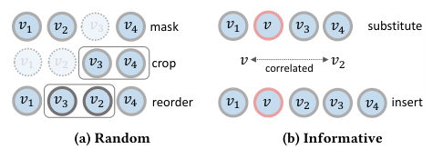

# 推荐自监督怎样构造有效视图

历史 $[耳机,耳机套,零食]$ 的下一次交互是降噪耳机。双塔用查询与降噪耳机形成正对，序列模型用前缀预测下一物品。若历史短、物品反馈少，这两个主任务都缺样本。对比式自监督从训练已有输入构造两份视图，把「同一物品」或「同一历史」本身变成标签。视图怎样改变输入，决定模型被要求忽略哪些差异。

## 同一个交叉熵的两种监督对象

给一个锚表示 $z_a$，在其他视图集合 $C(a)$ 中找它的正配对 $z_p$。用相似度 $s$ 和可选温度 $\tau$，最小化
$$
-\log\frac{\exp(s(z_a,z_p)/\tau)}{\sum_{b\in C(a)}\exp(s(z_a,z_b)/\tau)}.
$$
分子用索引选同源视图，分母含正列及其他样本。把一个正分数提高会降低损失，把其他分数提高会增加损失。相似商品或相似历史有时进入负列，因此批的构造决定会被推开的关系。主任务与辅助任务共用部分参数，按 $\mathcal L_{\rm main}+\lambda\mathcal L_{\rm ssl}$ 更新它们。服务沿主任务编码，再做物品打分或检索。对比视图在训练时提供条件扰动，无需用户在线提供两套历史。

| 方法 | 谁形成正对 | 视图怎样生成 | 共享参数和服务读出 |
|---|---|---|---|
| 物品字段遮蔽 | 同一降噪耳机 | 物品 ID 与元数据拆到相互补充的视图 | 专用 MLP 共享主塔嵌入表，服务走完整物品塔 |
| 物品字段丢弃 | 同一降噪耳机 | 两次独立采样丢弃字段，以 OOV 表示缺值 | 可共用物品塔和主损失，服务用完整字段 |
| CL4SRec | 同条用户前缀 | 连续裁剪、占位遮蔽、区间重排 | 共用因果序列编码器，辅助与服务都读末状态 |
| CoSeRec | 同条用户前缀 | 短历史以近邻替换、插入和遮蔽为主，较长历史可裁剪及重排 | 对比读取拼接的各位置状态，下一物品监督对正负候选分别计算 sigmoid 损失 |

物品论文的批内分母是 $N$ 个对侧视图，使用余弦与温度。序列两篇从 $N$ 条历史生成 $2N$ 个视图，排除锚点本身，用点积比较一份正对与 $2N-2$ 个负列。这些正对均从样本身份得到。作为比较，[BERT4Rec](从历史顺序预测下一物品.md) 的遮蔽训练需要识别被替换的物品 ID，错列是其他物品而非其他历史视图。依据见 [Yao 等 §3](../../来源/SRC-ITEM-SSL/阅读笔记.md)、[CL4SRec §3](../../来源/SRC-CL4SREC/阅读笔记.md)、[CoSeRec §4](../../来源/SRC-COSEREC/阅读笔记.md)。

## 扰动保留什么，模型就更可能学会什么

把耳机套遮蔽后，另外两个位置保留耳机与零食，模型还有分辨兴趣的证据。若随机裁出一个零食，强行把它和音频视图对齐，就可能削弱与下一条交互相关的信息。CoSeRec 用共用户频率和训练中的物品向量找相关项。用另一款耳机替换耳机，有机会保留音频兴趣。把它插到首项前，则可以保持全部历史内容。采用近邻后仍需检查语义，因为协同相似性也可能反映搭配或曝光。CL4SRec 的增广强度、CoSeRec 的长度阈值、两篇的对比损失权重都控制扰动与原始监督的相对贡献。

Liu 等作者原图 2，arXiv 2108.06479v1 第 4 页。沿两组图分别找变化的索引和保留的原节点，再判断变换后还剩哪些与目标有关的信息。[CoSeRec 增强方法](../../来源/SRC-COSEREC/阅读笔记.md#按历史长度选择怎样扰动)

## 稀疏性的统计口径与数据时间边界

新物品问题关心预测时是否有可用的 ID、内容与行为。用户历史长度关心用户此刻有几条已观测事件。Yao 等 AAI 用低频物品切片报告召回，CoSeRec 按短序列选择增强，两者的分母和应用互补。离线比较应按同一任务分别切初始交互数、物品频次、历史长度和索引覆盖，保留全量指标。小基线下相对比例容易很大，需同时看绝对值。两篇均报告全物品集合排序的 HR/NDCG，CL4SRec 明示从候选中排除用户已交互物品。训练阶段各自采负，CL4SRec 式 (15) 对一正一负做 sampled softmax，CoSeRec 式 (3) 给每个正负样本单独计算 sigmoid 交叉熵。全库评估还需对齐数据预处理、可见历史、候选过滤和基线重跑设置。两论文的 Beauty HR@20 中，CL4SRec 本文是 0.1056，CoSeRec 表 2 重跑为 0.0974。比较 CoSeRec 的相对改进应使用同文的 0.0974。[CL4SRec 式 (15) 与 §4.1.2](https://arxiv.org/pdf/2010.14395v2#page=6) · [CL4SRec 表 2](https://arxiv.org/pdf/2010.14395v2#page=7) · [CoSeRec 式 (3)](https://arxiv.org/pdf/2108.06479v1#page=3) · [CoSeRec §5.1.2 与表 2](https://arxiv.org/pdf/2108.06479v1#page=6)[AAI 切片](../../来源/SRC-ITEM-SSL/阅读笔记.md#长尾增幅受切片分母和实验口径影响) · [CoSeRec 同协议主表](../../来源/SRC-COSEREC/阅读笔记.md#同协议重跑基线比跨论文抄表更可比)

模拟时先确定预测所用的时间边界，再建共现表、查询物品元数据并截取前缀，最终从此前信息产生视图。若先用全序列含目标和后续行为建共现近邻，增强可能把正确答案带进训练样本。若使用新写入的元数据，还要确认试验时点能读到相同字段。相关近邻只在训练用，线上物品塔或序列编码器的输入契约保持对应主任务。[图传播的可见边](利用交互图传播协同表示.md) · [冷启动与迁移](../模块/多场景、迁移与冷启动.md#cold-start-stages)
