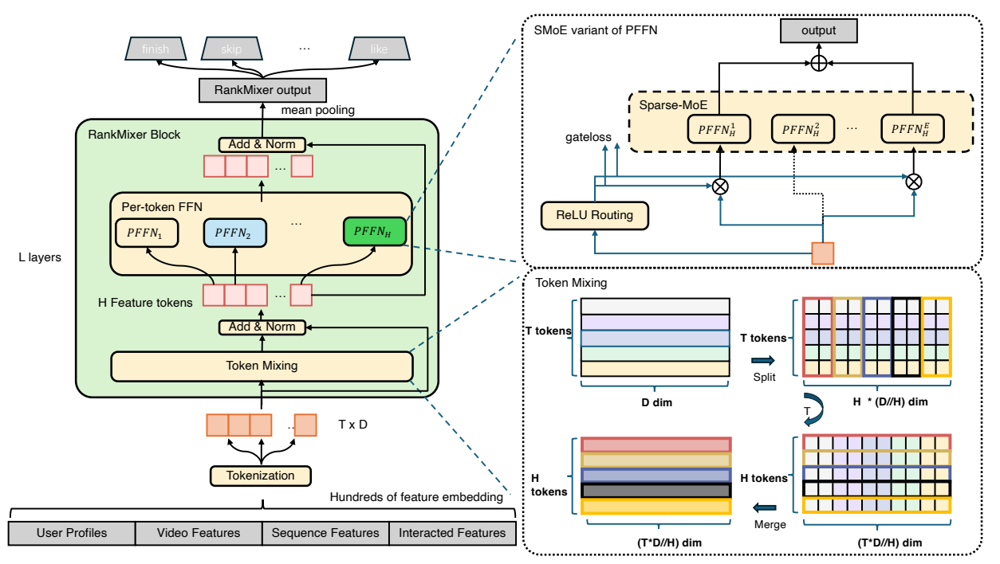

# 稀疏特征的低高阶交互学习：独立记忆、因子共享与矩阵交叉

用户、物品、时间、设备等特征单独出现时，往往不足以解释点击；“哪类用户在什么时间对哪个物品感兴趣”才是组合信号。困难是组合空间很大，而每种组合的观测很少。这里需要同时回答两件事：交互如何被表达，稀疏组合的参数如何通过其他观测得到学习。

DeepFM 给出的方案，是用 FM 显式表达一阶和二阶信号，再用深度网络补充复杂非线性；两者共享特征向量。[Wide & Deep](../../来源/SRC-WIDEDEEP/阅读笔记.md)则保留选定交叉的独立线性权重，配合嵌入MLP共同训练。[DCNv2](../../来源/SRC-DCNV2/阅读笔记.md)进一步在拼接嵌入上逐层做矩阵交叉，再用低秩混合控制预算。[FM](../../来源/SRC-FM/阅读笔记.md)给出了稀疏输入的因子共享与线性时间恒等式。[FFM](../../来源/SRC-FFM/阅读笔记.md)进一步区分一个特征面对不同字段时学到的关系。

## 从独立交叉权重到向量内积

对于编码后的稀疏向量 $x\in\mathbb R^d$，线性分数 $w^\top x$ 只能直接累加单个特征的贡献。手工加入 $x_i x_j$ 可以表达二阶关系，但独立权重必须等二者共同出现才能学习。

FM 将二阶权重写为 $\langle v_i,v_j\rangle$，$v_i\in\mathbb R^k$：

$$
z_{\mathrm{FM}}=w^\top x+
\sum_{i<j}\langle v_i,v_j\rangle x_i x_j.
$$

同一个 $v_i$ 被包含特征 $i$ 的不同组合复用，因此可以把其他组合中学到的表示用于稀少组合。这是参数约束带来的泛化机会，不是“从未共同出现也一定准确”的保证。公式按含义统一了原文式 (2) 中不一致的下标；原页见 [§2.1，PDF 第 3 页](https://arxiv.org/pdf/1703.04247v1#page=3)。

利用平方和展开，二阶项可以写为 $\frac12\sum_{f=1}^k[(\sum_i v_{if}x_i)^2-\sum_i v_{if}^2x_i^2]$，计算量由枚举特征对降为 $O(\operatorname{nnz}(x)k)$。这是从公式得到的代数分析；[精读中的展开与解释](../../来源/SRC-DEEPFM/阅读笔记.md#稀疏组合怎样获得可学习的参数)给出细节，不能把该复杂度当作整网实测。

## 同一特征面对不同字段时，哪些因子仍共享

取一次曝光，三个活动特征是 ESPN、Nike、Male，取值均为 1。若 FM 的标量教学因子是 0.5、0.2、−0.4，交叉分为 $0.10-0.20-0.08=-0.18$。ESPN 的改变量会同时改变它与广告主和性别两个字段的分数。FFM 则把特征 $i$ 的参数按对端字段 $f$ 记为 $v_{i,f}$：
$$
z_{\rm FFM}^{(2)}=\sum_{i<j}\langle v_{i,f_j},v_{j,f_i}\rangle x_ix_j.
$$
例如令 ESPN 的广告主视角为 0.5、性别视角为 0.4，令对端向量 $v_{\rm Nike,Publisher}=0.2$、$v_{\rm Male,Publisher}=-0.4$，并保持 Nike 与 Male 的字段因子取 0.2、0.1，新交叉分为 $0.10-0.16+0.02=-0.04$。ESPN×Nike 的数据梯度会改动 ESPN 的广告主视角。以后 ESPN 遇到另一广告主可复用这一视角。分字段能减少不同关系之间的牵制，也减少每套因子可共享的样本。

记总特征数 $d$、字段数 $F$、嵌入维度 $k$、活动特征数 $m$。FM 向量参数量为 $O(dk)$，平方和把二阶预测降到 $O(mk)$。FFM 允许 $O(dFk)$ 的字段因子，原论文通用逐对实现计算 $O(m^2k)$。可用哪些字段、活跃数和参数实际覆盖决定成本。[FM 评分编码、平方和及梯度](../../来源/SRC-FM/阅读笔记.md#从三次点积到平方和) · [FFM 表 2 与算法 1](../../来源/SRC-FFM/阅读笔记.md#字段表达力与稀疏存储一起变化)

FFM 的相同 CTR 比较中，可对照 FM 与 FFM 的 logloss、时间和早停，在某些设置下过拟合会抵消额外表达力。宽路可把 ESPN×Nike 设为独立权重，经带 L1 的 FTRL 更新来保留少量例外。FM 和 FFM 的变化来自打分参数的共享范围，FTRL 的变化来自更新与读出。[FFM 实验](../../来源/SRC-FFM/阅读笔记.md#结果依赖字段质量与停止轮次) · [逐次 CTR 更新](在线CTR怎样得到稀疏权重.md)

## 深度路径增加了什么，为什么要共享

将 $m$ 个域的向量拼接为 $a^{(0)}=[e_1;\ldots;e_m]$，进入 MLP：

$$
a^{(l+1)}=\phi(W^{(l)}a^{(l)}+b^{(l)}),\qquad
\hat p=\sigma(z_{\mathrm{FM}}+z_{\mathrm{DNN}}).
$$

$e_j$ 来自第 $j$ 域的特征向量，$W,b$ 是网络权重与偏置，$\phi$ 是隐藏层激活，$\sigma$ 将最终分数映射为 CTR。这里依原式 (1) 把深度输出理解为分支分数；原文对 DNN 末端另写 sigmoid，存在双重 sigmoid 的记号歧义，译文保留，尚未用官方代码裁定。[式 (1)、(3)–(4)，PDF 第 2–3 页](https://arxiv.org/pdf/1703.04247v1#page=3)。

FM 提供直接通往输出的显式二阶路径，MLP 提供更多非线性组合。MLP 也能表达低阶函数，不能把“偏重高阶”误读为严格的表达能力限制。两者共享 $v_i$ 后，同一向量同时接收来自 FM 与深网的梯度；不再先训练 FM 再初始化网络，也不维护两套各自独立的 Embedding。

| 比较项 | FM | FM & DNN（本篇基线） | DeepFM |
|---|---|---|---|
| 显式二阶分支 | 有 | 有 | 有 |
| 深度非线性路径 | 无 | 有 | 有 |
| 两条路径的表示 | 只有一条路径 | 各自学习 | 共享向量，联合更新 |
| 主要代价 | Embedding 与内积 | 两套表示及深网 | 共享表示及深网，仍需计算两条分支 |

DeepFM 的“无需特征工程”指不要求人工穷举额外交叉。编码、分桶、样本设计仍需决定。共享是否总有益没有一般保证：两个分支的梯度可能互相帮助，也可能产生优化牵制，应在同一数据协议下看消融与预算。[§2.2、表 1，PDF 第 4 页](https://arxiv.org/pdf/1703.04247v1#page=4)。

## 独立交叉记住例外，与深网共同拟合

Wide & Deep将选定交叉写成 $\phi_k(x)=\prod_{i:c_{ki}=1}x_i$，每个交叉学习独立权重。二值特征全部激活时才激活该交叉；所选集合可以有两项或更多项，不限二阶。宽、深两路输出logit相加，再做一次Sigmoid：

$$
p=\sigma\left(w_{wide}^{\top}[x;\phi(x)]+w_{deep}^{\top}a^{(l_f)}+b\right).
$$

$a^{(l_f)}$为嵌入与连续特征经过MLP后的末层激活。两路接受同一个logistic损失的误差，实验宽分支用FTRL加L1，深分支用AdaGrad；“共同训练”不要求相同优化器，也不等同共享嵌入。原文机制与例子见[精读](../../来源/SRC-WIDEDEEP/阅读笔记.md#宽分支选择交叉深分支共享表示)，[§3、式(1)–(3)，PDF第2–3页](https://arxiv.org/pdf/1606.07792v1#page=3)。

例如“安装应用A×展示应用B”的独立系数，只由该搭配激活的样本更新，可以保留精细例外；它本身不能借其他搭配学习一个从未激活的交叉系数，泛化主要由原始特征和深分支承担。FM的 $\langle v_A,v_B\rangle$ 则复用两者在其他搭配中学到的因子。前者提供独立容量但需选择组合，后者提供参数约束及共享机会，但低维表示未必保留所有小众例外。Wide & Deep关于稀疏高秩关系的解释是设计动机，没有实际秩估计或低秩失效证明。[§1，PDF第1页](https://arxiv.org/pdf/1606.07792v1#page=1)。

| 维度 | Wide & Deep | DeepFM |
|---|---|---|
| 直接交叉路径 | 人工选定交叉，每项独立权重，可不止二阶 | FM因子内积，直接表达二阶 |
| 深度路径 | 类别嵌入与连续值进入MLP | 域嵌入进入MLP |
| 两路耦合 | logit相加，同一损失；宽线性系数与深嵌入不是一套参数 | logit相加，同一损失且FM/MLP共用嵌入 |
| 稀疏组合取舍 | 精细例外与人工选取成本，未见组合依赖其他路径 | 因子共享减轻组合稀疏，同时约束二阶权重结构 |
| 原论文证据 | Google Play安装预测与三周线上获取率 | Criteo/私有数据点击预测，主要离线比较 |

两篇原实验不能直接排名。DeepFM中的Wide & Deep对照使用共享优化器，原Wide & Deep使用分支各自优化器；结构、优化和样本协议同时有差异，不能把全部数字差异单独归因于共享嵌入。共同输入MLP也不等于双塔物品预计算，逐候选成本需在[服务模块](../模块/在线服务、更新与计算效率.md)中实测。

## 向量交叉怎样把乘法压成一条标量路径

[DCN v1](../../来源/SRC-DCN/阅读笔记.md) 对拼接向量 $x_0$ 使用 $x_{l+1}=x_0(w_l^\top x_l)+b_l+x_l$。当前层先用长度 $d$ 的权重算一个标量，再把它乘回每个输入坐标，省下显式外积。若 $x_0=(2,3)$、$w=(1,0)$，零偏置首层得到 $(6,9)$。每个原坐标的乘数都等于 2，这一约束是线性成本的来源。无偏置多层项可以展开到 $L+1$ 阶，权重之间仍共享路径。CTR 通过交叉塔和深塔的共同读出监督。[§2–3，PDF 第 2–4 页](https://arxiv.org/pdf/1708.05123v1#page=2)。

## 矩阵交叉让每个坐标学习不同组合

DCNv2把字段嵌入与连续特征拼成 $x_0\in\mathbb R^d$，各字段嵌入可不等长。交叉层显式乘回原始输入：

$$
x_{l+1}=x_0\odot(W_lx_l+b_l)+x_l,\quad W_l\in\mathbb R^{d\times d}.
$$

第一层第 $i$ 个坐标为 $x_i\sum_jW_{ij}x_j+b_ix_i+x_i$；再加一层便可增加一阶，残差保留旧项。原DCN乘法项对应 $W_l=\mathbf1w_l^\top$，各坐标共享同一权重向量。矩阵版允许各行学习不同组合。偏置也有变化，v1 在残差上直接加偏置，v2 则将偏置放进乘回 $x_0$ 的括号。这是在嵌入坐标上交叉，仍通过嵌入在类别取值间共享参数，不能理解为给每个原始one-hot组合完全独立系数。[§3、式(1)，PDF第3页](https://arxiv.org/pdf/2008.13535v2#page=3)，[精读机制](../../来源/SRC-DCNV2/阅读笔记.md#每层乘回原始输入增加一阶而保留旧项)。

不含非线性门控/专家激活时，$L$层最高多项式次数为 $L+1$；但高阶系数由层权重路径乘积绑定。“包含所有交叉项”不等于任意系数可独立设置。原定理在无偏置、全一读出下分析，不能直接套到含MLP的整个模型。堆叠结构把交叉输出送入MLP，并行结构将交叉/MLP输出拼接后共同监督；两者不保证谁始终更优。[§4.1及附录，PDF第4–5、13–14页](https://arxiv.org/pdf/2008.13535v2#page=4)。

| 比较项 | Wide & Deep | DeepFM | DCNv2 |
|---|---|---|---|
| 直接交叉对象 | 选定的原始特征组合 | 稀疏字段的因子内积 | 拼接后的嵌入坐标与连续值 |
| 参数约束 | 每个所选组合独立权重 | 二阶权重经低维因子共享 | 跨层矩阵共享路径，高阶系数相互绑定 |
| 交叉阶数 | 所选组合可高于二阶 | 显式二阶，MLP补非线性 | 线性交叉部分随层数增至L+1 |
| 与深网关系 | 共同logit和损失 | 共同logit、损失及嵌入 | 交叉后接MLP，或两路并行 |
| 主要代价 | 选择/维护组合及MLP | 嵌入、FM计算及MLP | 全矩阵每层约d²，可低秩约束 |

FM只在相同嵌入坐标做内积，DCNv2的字段块 $W_{ij}$还能混合不同坐标。本文把简化FM式分数表示为一层交叉的特定块矩阵，是表达约束的比较，不意味着完整DeepFM训练过程被无条件等价替代。[§4.2，PDF第5页](https://arxiv.org/pdf/2008.13535v2#page=5)。

## 低秩节约矩阵成本，专家数量也占预算

将 $W=UV^\top$，$U,V\in\mathbb R^{d\times r}$，先降维再升维；约需 $2dr$ 个权重，忽略同样偏置时 $r<d/2$才严格少于 $d^2$。这是训练前的结构约束，并非训练完才压缩。DCN-Mix以多个这样的专家形成：

$$
x_{l+1}=\sum_{a=1}^K G_a(x_l)\left\{x_0\odot[U_l^aV_l^{a\top}x_l+b_l]\right\}+x_l.
$$

门控为Sigmoid或Softmax等，没有稀疏top-k路由，不能按“仅激活少数专家”估算。线性低秩混合主要成本为 $O(2L_cdrK)$；若采用原式(4)的低维非线性矩阵，还需 $O(L_cKr^2)$及门控开销。输入相关门控/非线性也使固定次数多项式解释不再直接适用。以上是矩阵运算分析，未包含嵌入词表、访存和整个服务链路。[§3.5–3.6，PDF第4页](https://arxiv.org/pdf/2008.13535v2#page=4)。

公开Criteo同篇比较中，DNN/DCNv2/DCN-Mix的Logloss为0.4421/0.4406/0.4408，AUC为0.8098/0.8115/0.8112；后两者表中参数3.5M/2.4M、FLOPS7.0M/4.8M。混合版成本约少31.4%，均值略有损失；并非已经测得同幅线上加速。两层、总秩256时，1/4/8/16/32专家Logloss为0.4418/0.4416/0.4416/0.4422/0.4420，不支持专家越多越好。[§7.3、§7.5、表6，PDF第9–10页](https://arxiv.org/pdf/2008.13535v2#page=10)。

第一层字段块范数可帮助诊断模型学习了哪些交叉，但既受嵌入尺度影响，也没有计入输入与后续网络，不是因果重要性。生产案例AUCLoss相对改善0.6%，分母是 $1-\mathrm{AUC}$；线上业务仅称显著，未公开增幅，不能转为CTR、收入或AUC绝对百分点。[§7.6–8，PDF第10–11页](https://arxiv.org/pdf/2008.13535v2#page=11)。原文定理和若干公式记号疑点保留在[精读](../../来源/SRC-DCNV2/阅读笔记.md#覆盖交叉项不等于任意多项式都能独立设权)，不据此补造实现。

## 交互也可以由字段内容或字段 ID 决定

[AutoInt](../../来源/SRC-AUTOINT/阅读笔记.md) 保留 $M$ 个字段向量。在每个头中，字段 $m$ 以自己的 Query 在 $M$ 个字段的 Key 上求权重，聚合其 Value。每头的源字段权重和为 1，多头拼接后与当前字段残差相加，再交给下一层。点击标签在整条曝光上监督。相比 DCNv2 直接为各拼接坐标做矩阵变换，AutoInt 的权重随当前样本变化。评分和聚合会引入字段数的二次项，层数对应信息交互的步数。[§4.4–4.7](https://arxiv.org/pdf/1810.11921v2#page=4)。

[CAN](../../来源/SRC-CAN/阅读笔记.md) 则让一侧被选中的 ID 查出一整组权重与偏置，作用于对端表示。若同一广告候选与用户历史的两条行为交叉，两次微型 MLP 可共享该候选提供的参数，行为值各自变化。这让模型保留部分 ID 特异性，又免于给每个 ID 组合新建完整 Embedding。序列汇聚、字段组合的选择、微网络宽度与数据传输共同决定成本。原文 §4.2 的一句字段指派与图 3 反向，按图 3 可以用候选提供参数、行为提供输入作示例。[§4，图 3](https://arxiv.org/pdf/2011.05625v3#page=4)。

复用时可检查同一曝光的三个计算位置。向量/矩阵交叉的参数固定，输出由坐标乘积变化。AutoInt 为样本中的字段对动态生成混合权重。CAN 在选定字段对中动态更换小网络参数。三者都受 CTR 监督，但字段选择、缓存边界和在线计算形状不同。IntTower 的用户与候选编码可独立缓存或复用，将联合作用集中在后续匹配分数，见[粗排预算](粗排如何在计算预算内保留精排候选.md)。

## 固定混合与逐Token网络：把交互组织成大矩阵计算

[RankMixer](../../来源/SRC-RANKMIXER/阅读笔记.md)接收已知候选的用户、物品、历史和交叉特征，输出完播、快划等任务分数，属于精排交互骨干，不是生成物品码的召回器。它把语义分组后的Embedding拼接并按固定宽度切片、投影为 $T\times D$ 连续Token；这里的Token化不涉及离散码本。

*Jie Zhu等作者原图1，2507.15551v3，PDF第3页；与精读引用同一文件。左侧按输入→重复块→池化→任务分数阅读，右下显示先分头再跨Token重组，右上为稀疏专家变体。*

每个Token分 $H$ 个头，同号头跨Token拼接；设 $H=T$，重排前后都为 $T\times D$，然后残差和LayerNorm。它是无参数置换，跨特征的可学习非线性来自后续逐Token FFN及多层组合，不能称为动态Attention。每行有独立的 $D\to kD\to D$ FFN，既不同于Transformer各行共享同一FFN，也不同于MMoE多个专家读取同一完整输入。混合后各行已含跨组信息，因此“逐Token”不是整个网络始终隔离各字段。[§3、式(1)–(9)，PDF第2–4页](https://arxiv.org/pdf/2507.15551v3#page=2)，[两行数值例与监督梯度](../../来源/SRC-RANKMIXER/阅读笔记.md#固定重排怎样让不同特征进入同一个网络)。

同 $T,D,k,L$ 下，共享与独立FFN都执行 $T$ 次同形变换；解除共享约使存储参数乘 $T$，主要算术量近似不变，但参数内存和访问模式会变。若再扩大宽度、Token数和层数，稠密版近似 $P\approx2kLTD^2,F\approx4kLTD^2$，FLOPs仍增加。DCN-Mix以低秩参数化控制交叉矩阵预算，RankMixer则通过Token组织、独立FFN与大矩阵执行改造容量和硬件利用方式，不能仅按“都有专家”将两者等同。

稀疏变体用 $g_{ij}=\max(0,h(s_i)_j)$ 与 $v_i=\sum_jg_{ij}e_{ij}(s_i)$，加 $\lambda\sum_{ij}g_{ij}$ 控制门值和；没有归一化Softmax或固定Top-k。训练／推理双路由器仅对后者施加稀疏正则，推理只用后者；正文缺少完整双路由联合训练式，不能补造每步全专家激活的实现。它与未做稀疏Top-k的DCN-Mix在预算上需分别计算。[§3.4、图3，PDF第4、6页](https://arxiv.org/pdf/2507.15551v3#page=4)。

同篇离线表中，RankMixer-100M完播AUC收益+0.64%、107M参数、每批233G FLOPs；DCNv2为+0.13%、22M、170G，Wukong为+0.29%、122M、442G。不是整表严格等参／等算力实验；增幅原文未明示相对量还是绝对百分点，沿用其百分号。去混合／改共享FFN的消融为-0.50%／-0.31%，后者同时减少容量，不能单独证明隔离必然解决高频支配。[表1–3，PDF第5–6页](https://arxiv.org/pdf/2507.15551v3#page=5)。

生产表同时改变架构、MFU和fp32→fp16：15.8M→1.1B、107G→2106G、MFU4.47%→44.57%、14.5→14.3ms。参数约69.62倍，FLOPs按数字约19.68倍，与表列20.7倍不符；不能精确支持摘要的百倍，也不构成另一硬件和QPS下的成本保证。线上活跃天数+0.2908%、时长+1.0836%属于该生产A/B条件，不能与其他论文不同数据的CTR或AUC直接排名。[表4–6，PDF第7页](https://arxiv.org/pdf/2507.15551v3#page=7)。

## 离线优势需要放回协议中理解

作者在 Criteo 约 4500 万记录的随机 90/10 切分中报告，DeepFM 的 AUC/Logloss 为 0.8007/0.45083，FM 为 0.7892/0.46077，PNN* 为 0.7987/0.45214；在 Company* 约 10 亿记录、7 天训练后 1 天测试的协议中，DeepFM 为 0.8715/0.02618。它支持在这些实现和设置下联合路径有效，不能跨数据直接比较绝对 AUC。[表 2，PDF 第 5 页](https://arxiv.org/pdf/1703.04247v1#page=5)。

本篇 Wide & Deep 对照由作者自行实现，采用共享优化器；未完整提供随机种子、重复区间与独立验证集。其效果差异不足以单独识别每一处结构改动的因果作用。图 6 是相对 LR 的训练耗时，未测出本方法线上单次时延；文中在线 CTR 和收入段落也不是 DeepFM 本篇的 A/B 实测。

选择模型时，先检查监督是否确为曝光点击，再考虑低阶共享能否帮助稀疏组合、深网收益是否覆盖逐候选成本。DeepFM 的联合输入不能直接拆成可缓存物品表示的双塔；输出落在 $(0,1)$ 也不保证概率校准。后者属于 [精排模块中的概率校准问题](../模块/精排、交互与概率校准.md#q-calibration)，需要另外验证，不能用 AUC 优势代替。

Wide & Deep另提供了线上证据：三组各1%用户、持续三周，纯宽/纯深/联合模型的离线AUC为0.726/0.722/0.728，后两者线上安装获取率相对纯宽+2.9%/+3.9%。纯深AUC较低却线上收益较高，说明固定曝光离线指标与决策收益不等价；未公开置信区间和检验方法。正文“较纯深+1%”约为1.039/1.029−1≈0.97%的实际相对提升，不是安装率绝对增加1个百分点。[§5.1、表1，PDF第4页](https://arxiv.org/pdf/1606.07792v1#page=4)。

DCNv2的Criteo使用前6天训练、最后一天等分验证/测试，充分调参后五次初始化报告均值/标准差；DeepFM原文则为随机90/10切分。因此两篇绝对数字不能直接排名。DCNv2同篇实验中强DNN接近多数基线，也提示应把样本协议、搜索预算、实际参数与服务成本一起比较，不能将结构名称本身当作效果保证。
